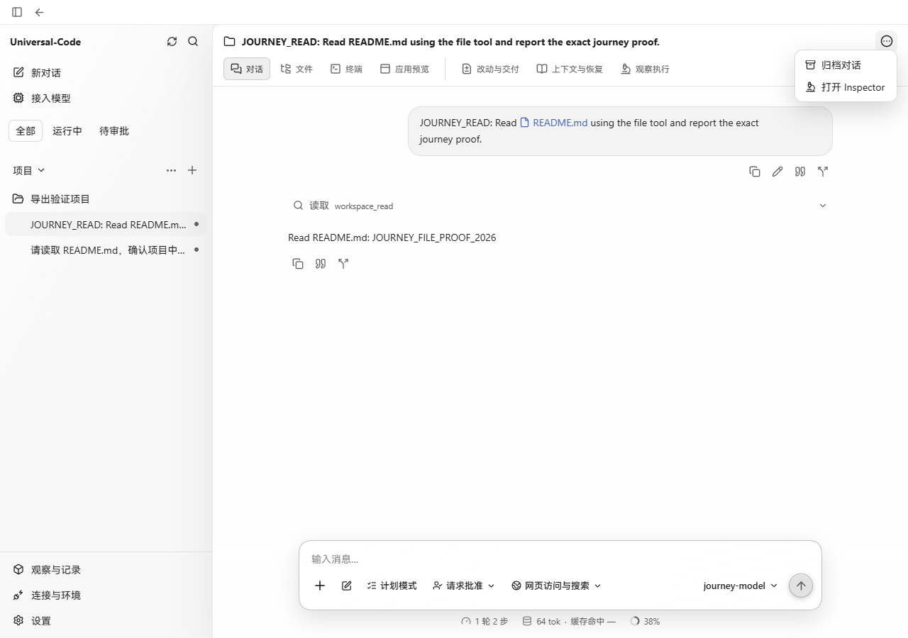
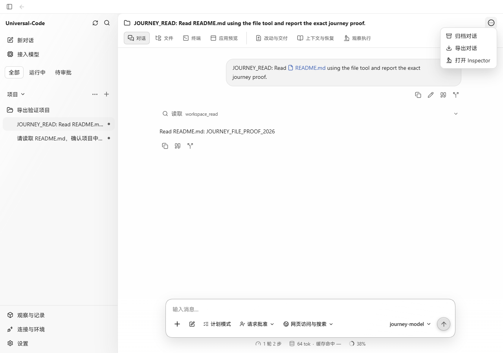
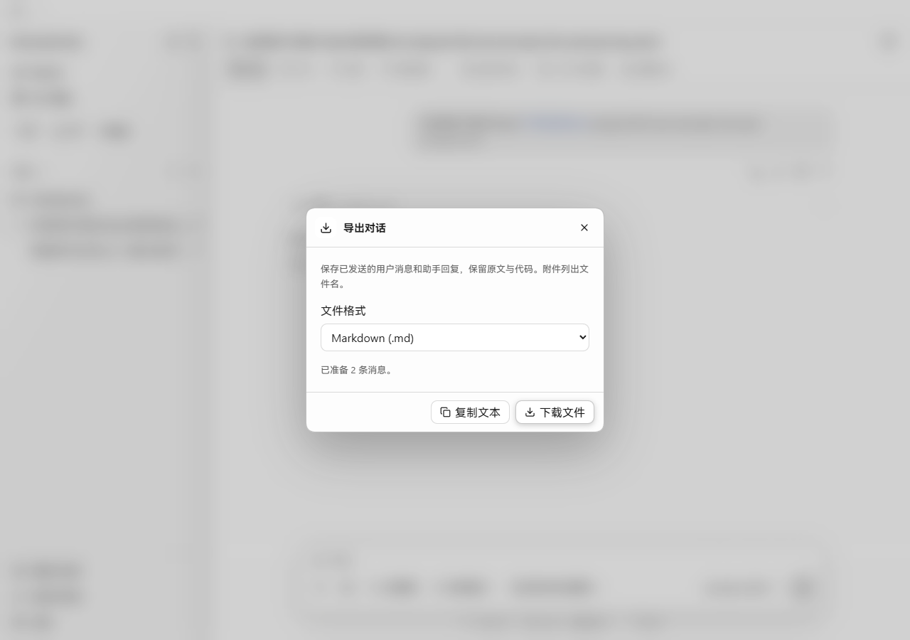
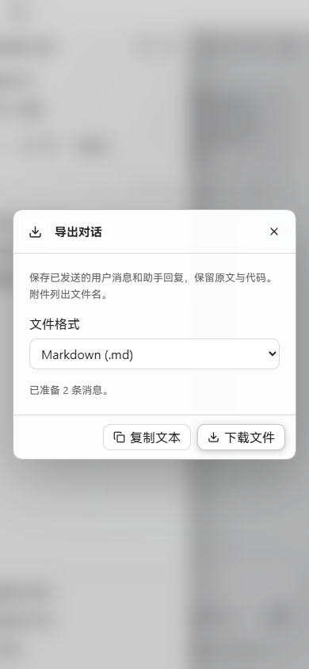

# 对话导出

对话右上角菜单新增“导出对话”。可选择 Markdown 或文本格式，下载文件或复制到剪贴板。中英文界面均可使用；附件保留文件名，待处理和撤回消息保留状态。

导出逐页读取整个对话，并通过现有公开消息接口取回完整正文，不受当前聊天窗口页数或正文预览长度影响。只有全部读取成功才允许复制或下载；读取失败可重试，关闭窗口会取消读取。系统提示、工具内部事件与尚未保存的流式文本不进入导出。公开 commentary 和分支继承回复的完整正文沿用公开投影与脱敏检查。

Markdown 和文本导出保留原始正文的首尾换行、空格、制表符与代码缩进。相邻助手消息仍按聊天投影合并，重复结束回复不额外导出；各段有效正文之间保留两个换行作为分隔。聊天页面的显示格式不变。

## 真实页面验证

2026-10-22，Windows Edge，生产前端与生产 API/SQLite。基线为 `10311148`；修改前后的截图使用同一份已保存的对话。通过 `cmd/workbenchjourney` 的离线模型提供者实际读取 README，再由界面导出；对话、消息读取、剪贴板和下载都使用真实执行路径。

| 修改前：对话菜单 | 修改后：对话菜单 |
| --- | --- |
|  |  |

1280 × 900 导出窗口：

390 × 844 窄窗口：

浏览器实际下载了 `.md` 和 `.txt`，两份文件与系统剪贴板均包含原始用户请求及 `Read README.md: JOURNEY_FILE_PROOF_2026` 助手回复。以上为生产网页验证；未作为原生打包窗口验证。

## 自动检查

- `npm test -- src/v2/thread-export.test.ts src/v2/components/thread-export.test.tsx src/v2/components/conversation.test.tsx`：65 个测试通过，覆盖历史分页、多 run 顺序、长正文、公开消息过滤、失败禁止部分导出、重试、取消、剪贴板错误和切换聊天关闭窗口。
- `go test ./internal/store -run 'TestSavedPublicCommentary|TestThreadSearch' -count=1`：通过，覆盖公开 commentary、分支继承正文、跨聊天隔离、脱敏及现有搜索行为。
- `go test ./internal/httpapi -run 'TestSavedMessageSearch' -count=1`：通过。
- `npm run build`：通过。格式控件样式与英文单数文案调整后，导出组件测试及生产构建再次通过。
