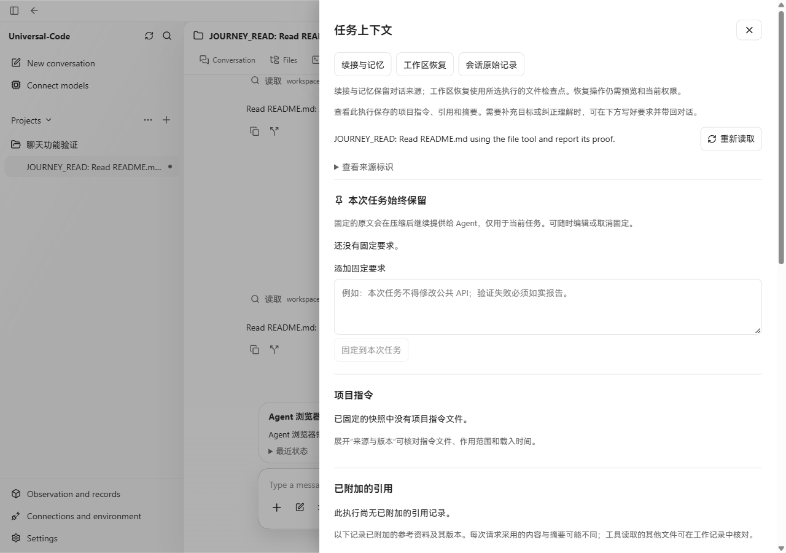
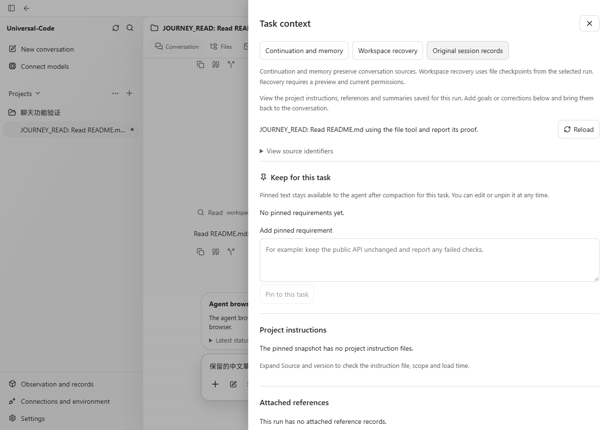
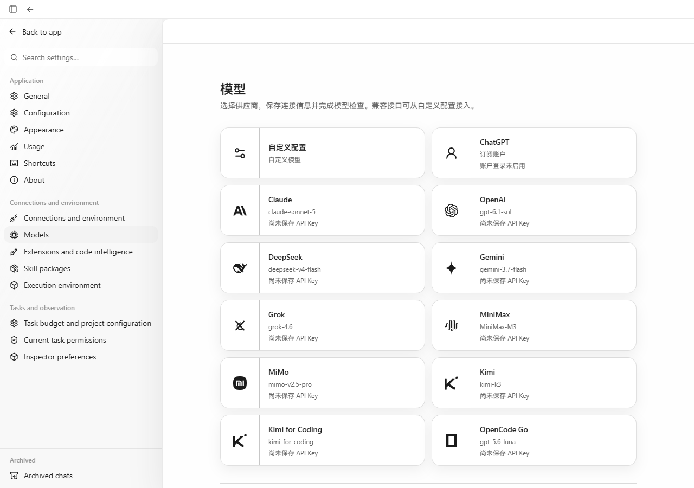
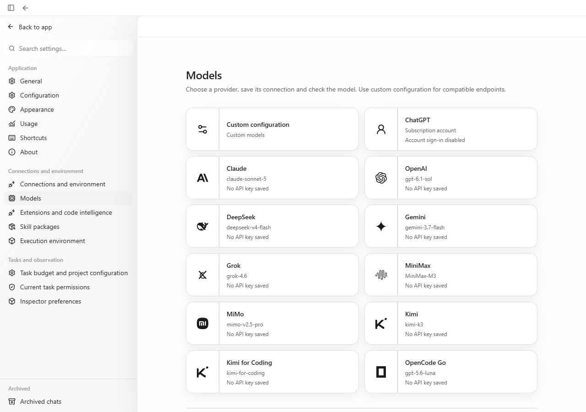
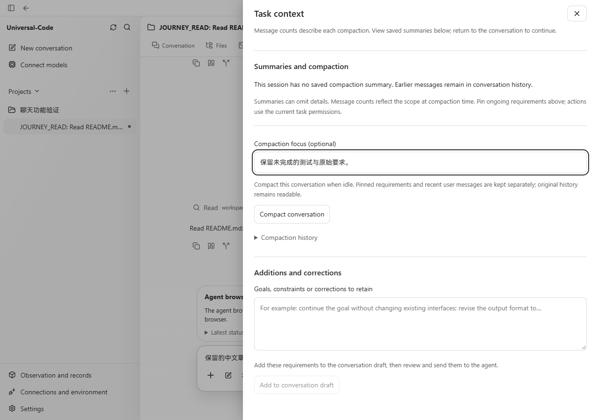

# 聊天与设置的中英文切换

语言切换原先只覆盖部分导航，英文界面的固定要求、上下文压缩、模型配置和交付工具仍夹杂中文。本次沿用现有 `LocaleProvider`，补齐这些页面的标签、说明、错误提示与辅助功能名称。

## 参考与取舍

本机 Codex 26.1013.4894.0 的资源包含中文界面，设置提供语言选择；因此保留中文和英文两种界面语言，并让已有界面文字随选择变化。发送方式、快捷键和消息操作的参考依据另见 [聊天功能说明](chat-productivity.md)及 [Codex 设置文档](https://learn.chatgpt.com/docs/app/settings)。本项采用 Codex 的界面语言策略。

翻译范围是应用界面。用户消息、模型回复、固定要求的原文、文件内容、命令输出、路径、模型名称和服务返回的原始诊断继续保留。切换语言不重建草稿，不改写已保存的请求、任务内容或操作标识。

## 修改内容

- 补齐固定要求、压缩与恢复、上下文诊断、计划与批准、排队消息、附件和资源菜单。
- 补齐模型与凭据设置、执行环境、网页访问、Agent 浏览器、应用预览、任务改动、Git 和 PR 页面。
- 将活动状态和工具操作的界面标签与原始消息区分；执行状态直接参与判断，避免语言切换改变文件引用的可用性提示。
- 已保存的本机恢复记录保持原样，在显示时翻译已知的前端错误。原始服务错误继续显示原文。
- 已有应用启动草稿在切换语言后继续复用，避免重复插入启动要求。模型设置切换语言保留输入中的配置，并使用当前语言校验重复 JSON 字段。

## 真实页面对比

截图来自 Windows Chromium，视口均为 1280 × 900。使用生产前端及 `workbenchjourney` 的真实 API、SQLite 和项目目录；只有模型回复使用仓库的离线测试提供者。没有替换 DOM 或生成界面图。截图展示浏览器中的生产渲染结果。

上下文的修改前为 main `2bbdab93`；模型页面修改前为 `33a9e03f`，其模型设置源文件与 #414 基线 `1d6582a5` 一致。修改后为 `39ac142c` 的生产构建（合入 #414 后这些前端文件未变化）。

| 页面 | 修改前：已选择英文但正文仍为中文 | 修改后 |
| --- | --- | --- |
| 任务上下文 |  |  |
| 模型设置 |  |  |

压缩界面显示英文，输入的中文要求保持原文：

## 验证

- 前端完整测试通过：256 个测试文件、2500 项测试。
- 生产构建和 TypeScript 类型检查通过。
- 单元和组件测试覆盖语言切换后的配置校验、资源菜单结果、原文保留、草稿恢复、排队消息、浏览器权限、交付与 Git/PR 操作。
- 实际页面验证英文模型设置、聊天草稿保留，以及固定中文要求的保存、编辑和取消编辑。
