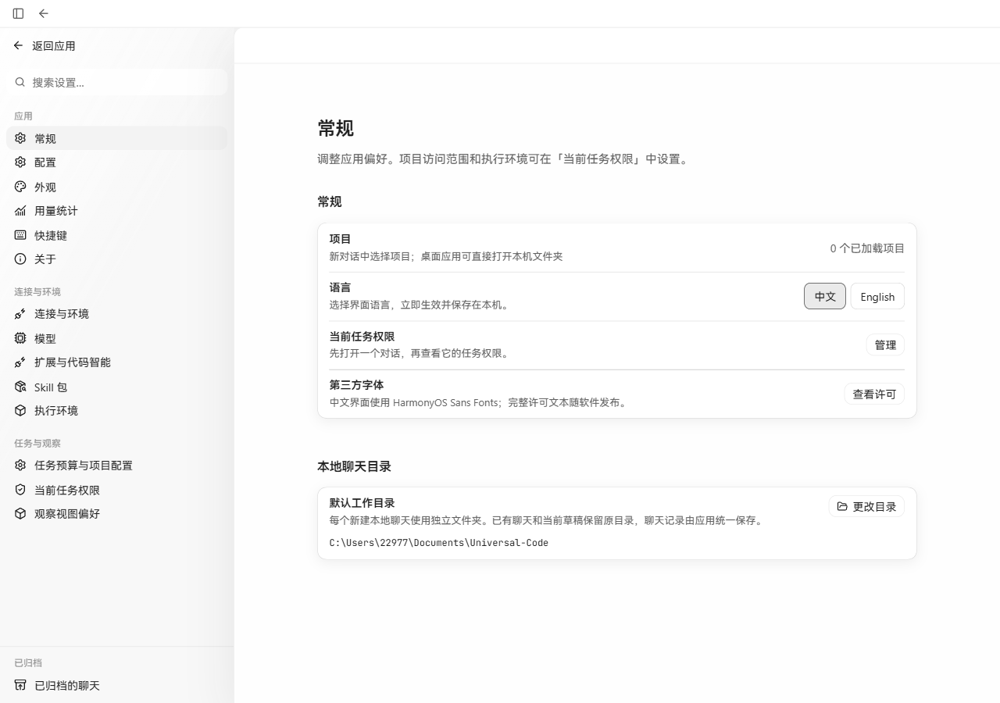
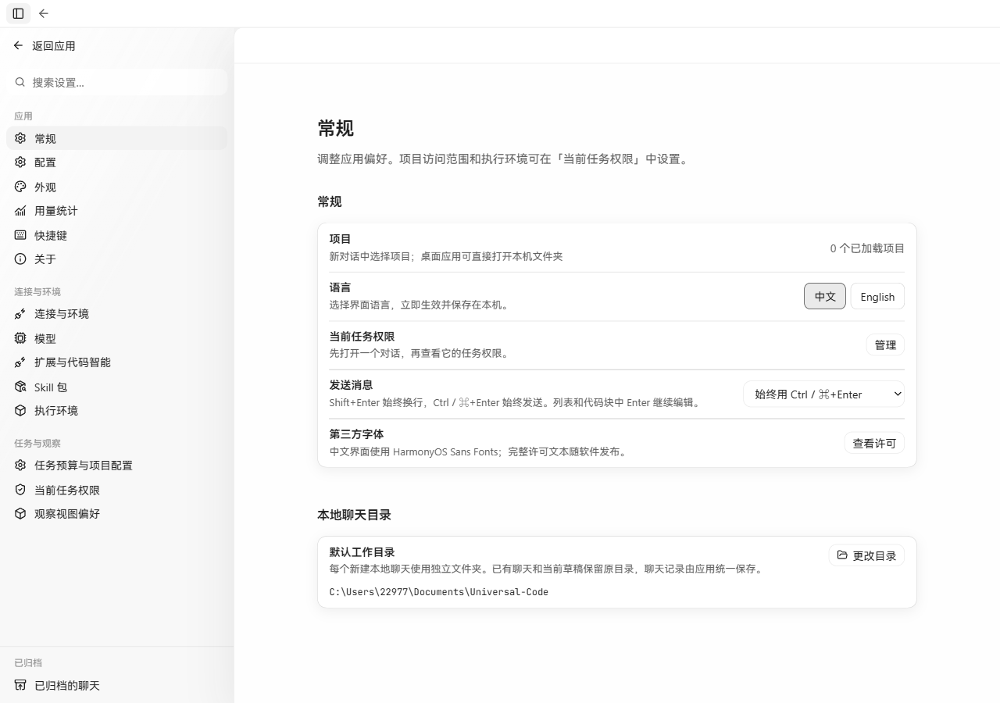
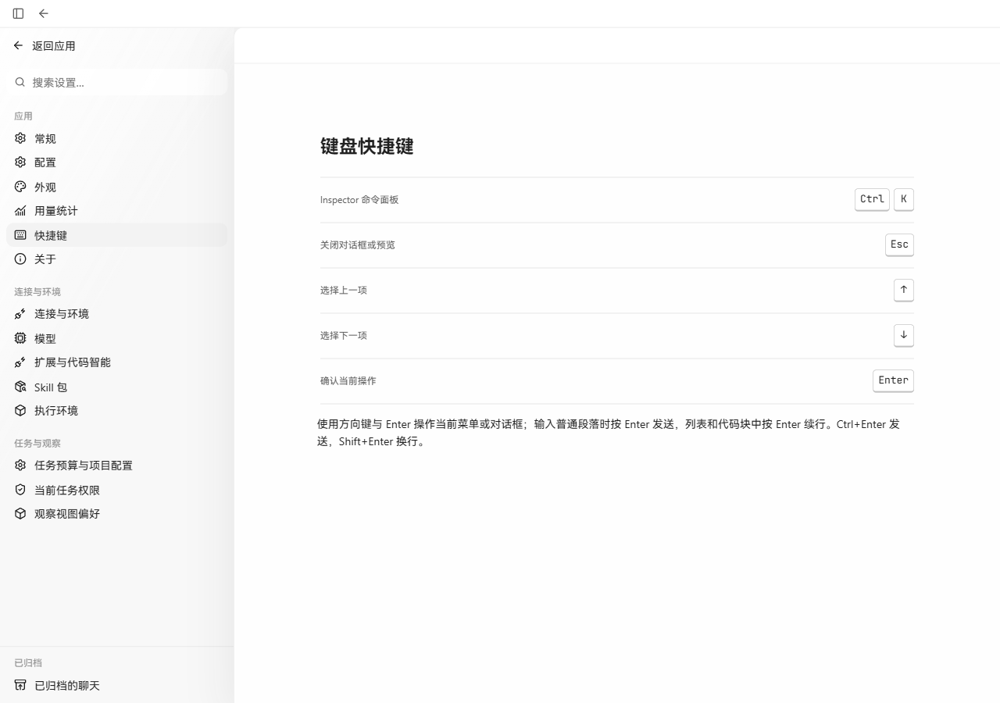
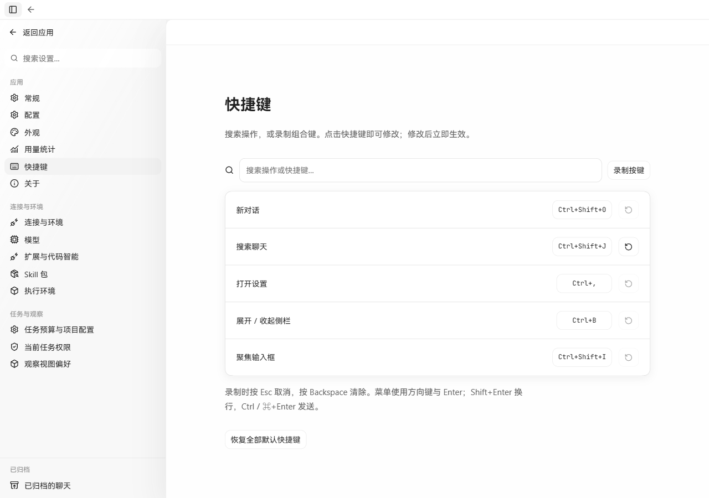
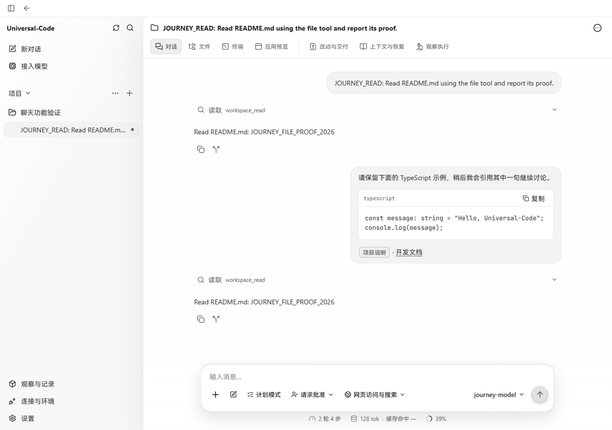
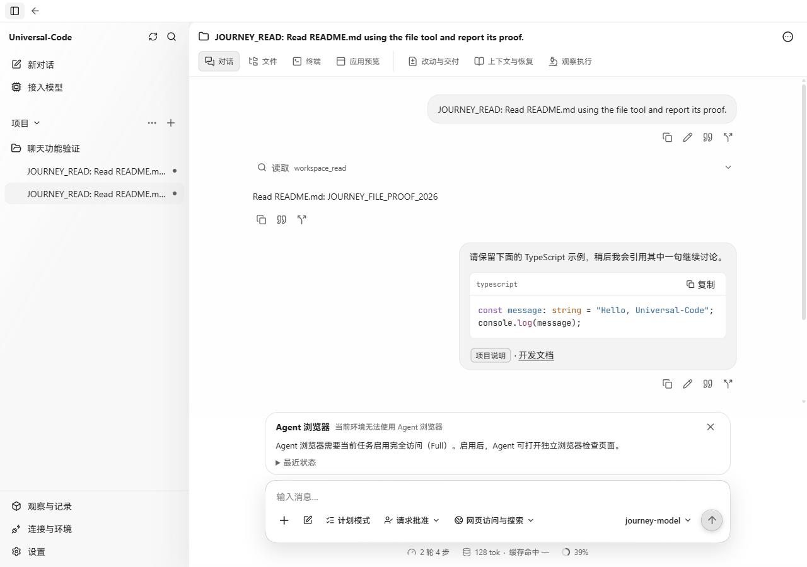
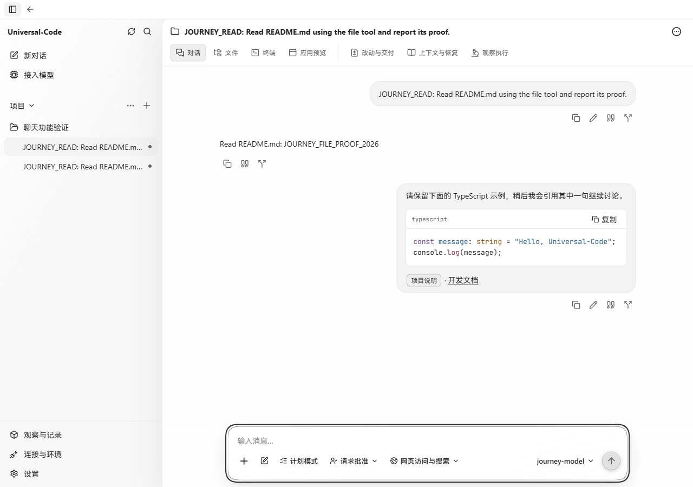

# 聊天发送、消息复用与快捷键

## 采用的交互

- 发送偏好采用 [Codex 设置](https://learn.chatgpt.com/docs/app/settings)的三种方式：Enter 发送、多行消息用 Ctrl/⌘+Enter、始终用 Ctrl/⌘+Enter。Shift+Enter 换行；列表与代码块中的 Enter 保留编辑行为。切换设置不会重建编辑器。
- 快捷键采用同页的搜索、录制、修改和恢复默认方式，覆盖新对话、搜索聊天、设置、侧栏和聚焦输入框。冲突会明确提示，文本编辑与浏览器的常用组合键不允许覆盖。
- 已处理用户消息增加复制、回填文字、引用和分支。Codex 已提供用户消息复制/编辑、引用和分支；本实现的回填与引用追加到已有草稿，选中文字时只引用选区。复制和回填读取保存的完整原文，而不是可能截断的聊天预览。读取失败时保留草稿。
- 分支保留选中用户消息及之前的对话，原聊天继续保留，选中消息之后的回复不进入新聊天。待处理、撤回消息不能作为分支起点。历史回复保留来源，不会错误请求新分支中不存在的文件改动。
- [Claude Code](https://github.com/anthropics/claude-code/blob/main/CHANGELOG.md)已采用代码语法高亮。本实现按代码块语言标签加载 highlight.js，保留原文复制，不猜测未知语言，也不执行代码中的 HTML。高亮代码单独加载，当前压缩后约 24 KB。

没有为普通代码块增加独立的换行和展开/收起开关：本轮没有找到这两个控件在参考产品中的明确对应实现。Claude Code 的完整输出展开与普通 Markdown 代码块折叠不是同一项交互。

## 真实页面前后对比

基线为 main `2bbdab93`，修改后为本 PR。两侧均使用同一套生产前端和 `workbenchjourney` 生产 API/SQLite 流程，在 Windows Chromium 的 1280 × 900 视口截图。只有模型回复由仓库的离线测试提供者产生；对话、草稿、分支和设置均通过实际页面操作。截图未替换页面 DOM，也未生成模拟界面。

| 位置 | 修改前 | 修改后 |
| --- | --- | --- |
| 发送设置 |  |  |
| 快捷键 |  |  |
| 用户消息和代码块 |  |  |

从第二条用户消息分支后，保留第一轮回复与选中消息，第二轮回复被截断：

## 验证

- 前端测试覆盖发送模式、富文本/纯文本、IME、快捷键冲突与重置、完整消息读取、草稿保留、选区引用和安全高亮；生产构建通过。
- Go 测试覆盖用户消息分支、消息提交顺序、撤回/待处理拒绝、重复请求、原聊天保留，以及历史回复来源。
- 浏览器实际检查剪贴板文字、完整原文回填、选区引用、持久化分支，以及设置改变后的快捷键行为。截图为网页运行结果；没有将其作为原生打包窗口验证。
