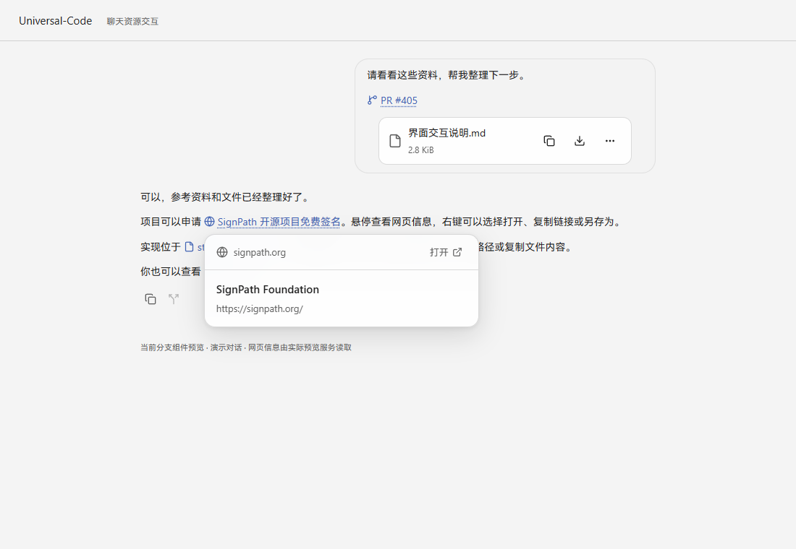
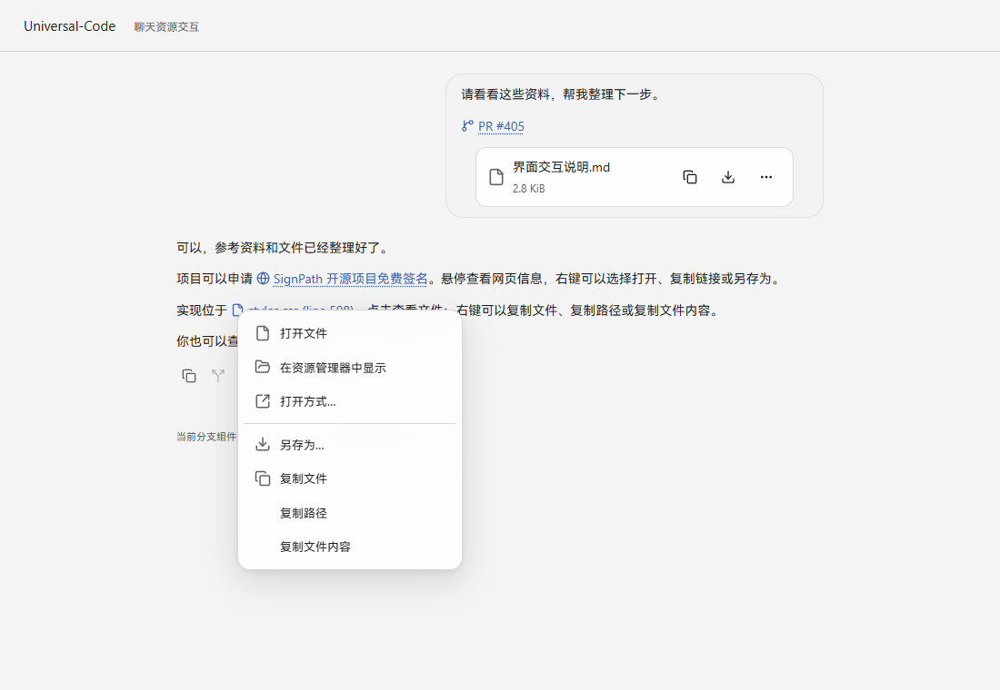
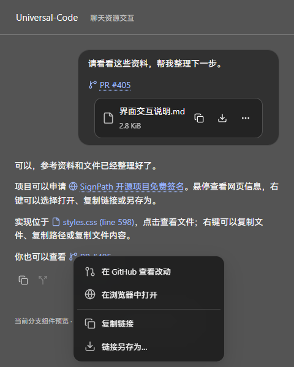
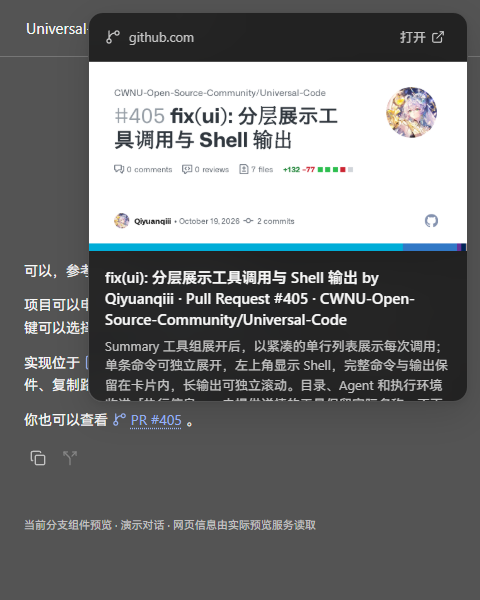

# 聊天中的链接与文件

用户消息和 Agent 回复使用相同的资源交互。

| 内容 | 点击 | 右键 / 更多操作 |
| --- | --- | --- |
| HTTP / HTTPS 地址 | 在系统默认浏览器中打开 | 在浏览器中打开、复制链接、链接另存为；GitHub PR 可直接查看改动 |
| 工作区文件路径 | 查看文件并跳到指定行；图片打开原图查看器，PDF / Office 文档交给系统应用 | 打开、在资源管理器中显示、打开方式、另存为、复制文件、复制路径、复制文件内容 |
| 已发送的文件附件 | 文本可预览 | 复制文件、下载、打开、打开方式、另存为、复制文件内容 |
| 已发送的图片 | 原图查看器，可缩放、复制和下载 | 打开图片、复制图片、图片另存为 |

Windows 桌面端的“复制文件”写入系统文件剪贴板，可以粘贴到输入框成为附件，也可以粘贴到资源管理器。图片以 PNG 写入图片剪贴板，输入框沿用图片粘贴入口。复制文件内容则粘贴为文字。复制失败会显示原因。

普通网址自动缩短显示；GitHub PR 显示为 `PR #编号`。Markdown 中原有的描述性标题保留。文件路径显示文件名和行号，悬停显示完整路径。命令代码块中的路径保留原文。网页悬停卡片提供标题、摘要和站点预览图；实际内容取决于网站提供的信息。

## 截图

下面使用此分支的实际聊天组件渲染演示对话，网页信息来自真实 SignPath / GitHub 请求。页面中的原生桥接动作以记录调用替代，因此截图用于核对界面；Windows 剪贴板另有原生测试。并非打包桌面应用的整窗截图。

| 480 × 600：网址菜单 | 480 × 600：网页预览 |
| --- | --- |
|  |  |

菜单限制在窗口内，支持方向键、Home / End、Escape 和 Shift+F10。预览卡片按链接上下的可用空间限制高度，内容可滚动，不遮住触发它的链接。

## 实现范围

- 桌面应用继续限制渲染器导航；HTTP / HTTPS 点击通过独立的原生接口交给浏览器。外链打开支持本地开发地址，不要求网页预览成功。
- 网页信息只在悬停或聚焦时请求，通过已有的公共 HTTPS 请求器获取，不携带应用凭据。预览 HTML 和图片各最多 512 KiB；“链接另存为”下载公共 HTTPS 资源，最多 2 MiB。
- 文件操作读取已保存附件或注册工作区内的文件，最多 5 MiB；历史回复按照该次运行绑定的物理目录读取。绝对路径也必须在对应工作区内。二进制文件用“复制文件”，不作为文字复制。
- Windows 已实现文件对象复制和“打开方式”。macOS / Linux 的文件对象剪贴板与应用选择器尚未实现，界面会返回明确提示；保存文件和默认打开仍有对应实现。

## 验证

- 前端覆盖用户 / Agent 外链、导航保护、短标签、行号、历史运行、悬停卡片、键盘菜单、复制失败反馈、附件复制和生成图片查看；同时检查原有输入框粘贴、图片查看器和流式文字行为。
- Go 覆盖存储附件读取、工作区文件读取、越界路径、跨工作区引用、文件大小和二进制内容，以及原生接口的公开方法列表。
- Windows 原生 CF_HDROP 写入后，通过现有文件剪贴板读取器读回，核对中文文件名和原始字节；测试后恢复原剪贴板。
- SignPath 和 GitHub 元信息已通过真实网络读取；Edge 已检查浅色与深色的资源菜单和预览，以及 480 × 600 的可见范围。浏览器页面用桥接替身核对交接调用，未将它作为系统默认浏览器 / 保存对话框的端到端证明。

原生剪贴板测试会改动剪贴板，默认跳过。手动运行前应保存剪贴板：`UC_TEST_NATIVE_CLIPBOARD=1 go test ./internal/desktop -run TestChatFileNativeClipboardRoundTrip -count=1`。真实预览请求也默认跳过，指定 `UC_PREVIEW_EVIDENCE` 输出路径，必要时用 `UC_PREVIEW_URL` 指定目标。
