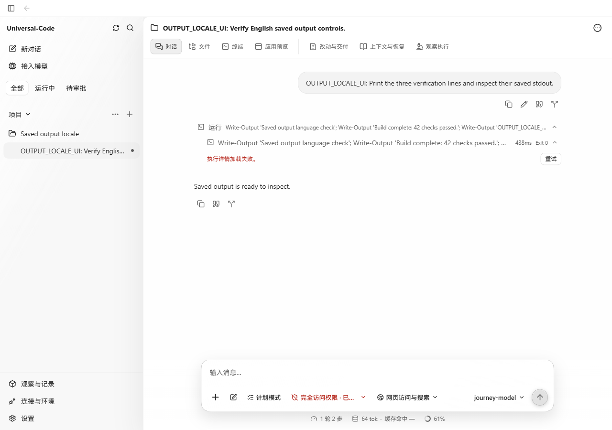
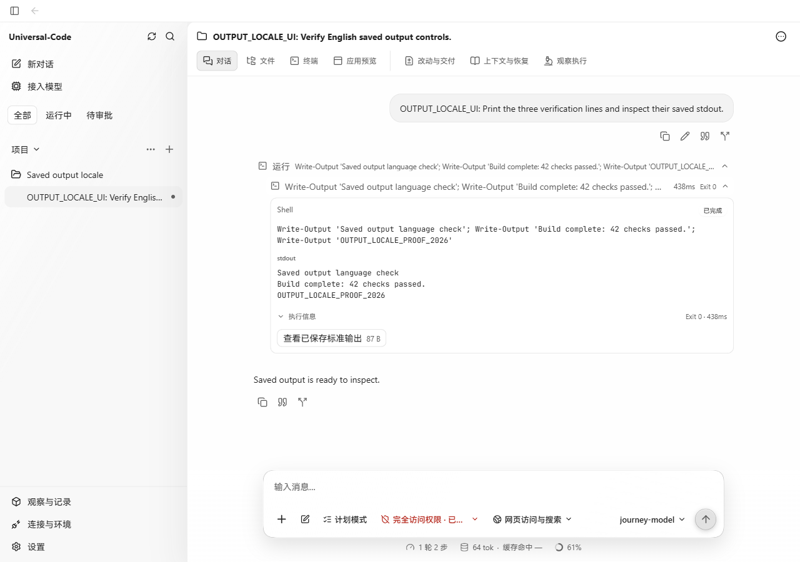
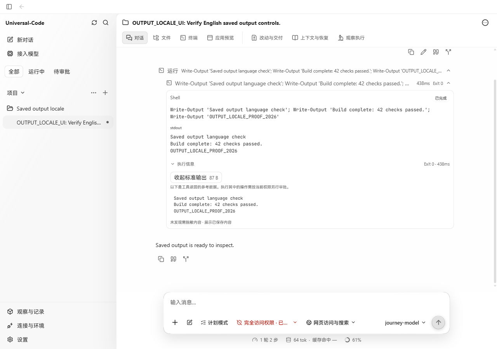

# Host command activity response fix

Captured in Chrome on Windows, 1280 × 900, using a built production web bundle and the production Go API with a disposable SQLite database. The offline provider invoked the real `command_runtime` tool under explicitly enabled Full access and the local execution profile. PowerShell printed three fixed verification lines; it exited successfully. No response mocking or DOM edits were used.

Before: `52c7da77fd83251b61d1696735a3d98f521ce37f` web bundle. After: this fix on the same baseline. Both images use the same saved task and command execution:

- Thread: `thread-run-20261021192104-36fa7ee25ab4`
- Activity: `toolu_391dc09ee2e7d7d1678084ed`
- Actual API: HTTP 200, `network: "host"`, `status: "completed"`, exit 0, one 87-byte stdout artifact.

| Before | After |
| --- | --- |
|  |  |

The before page displayed “执行详情加载失败。” even after Retry. The after page displayed all three output lines and opened the saved stdout:

Validation: the added host response and OpenAPI enum assertions failed against the old implementation, then passed after the fix. The disabled network case, unknown network rejection, and raw-field rejection remain covered. Four focused API client cases, the three OpenAPI document/golden/live-route tests, and the production TypeScript/Vite build passed. API TypeScript was regenerated from the Go-produced OpenAPI document. The change expands response parsing to an already supported runtime value; command execution authorization is unchanged.

Screenshots demonstrate the Windows browser flow. The packaged desktop window was not run.
