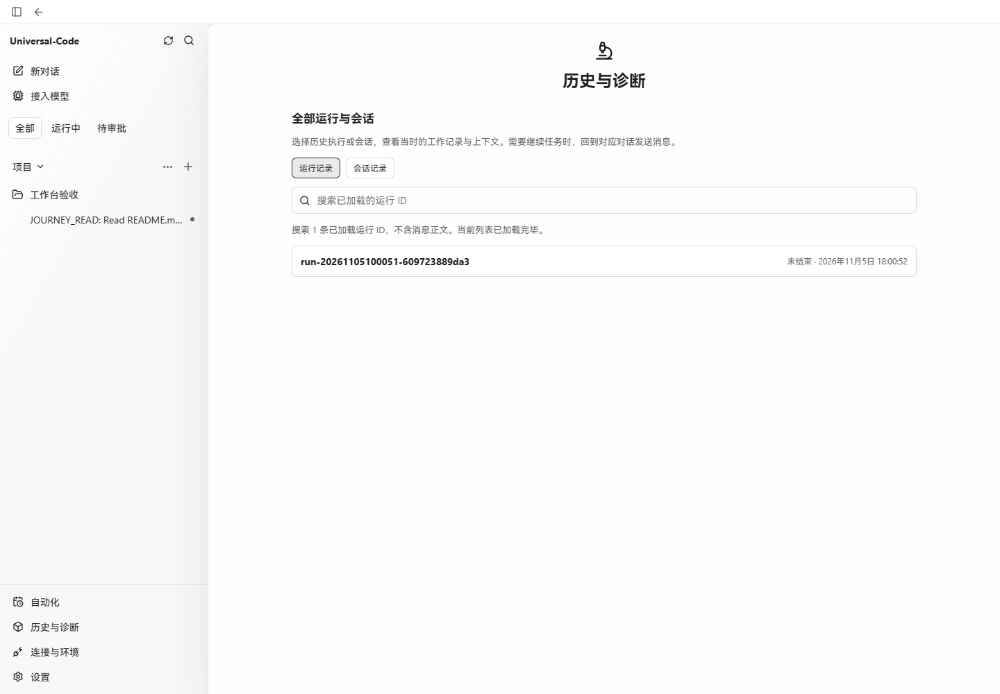
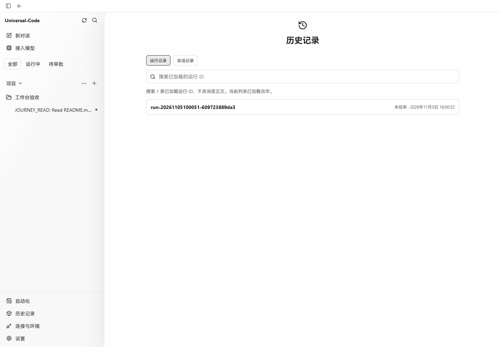
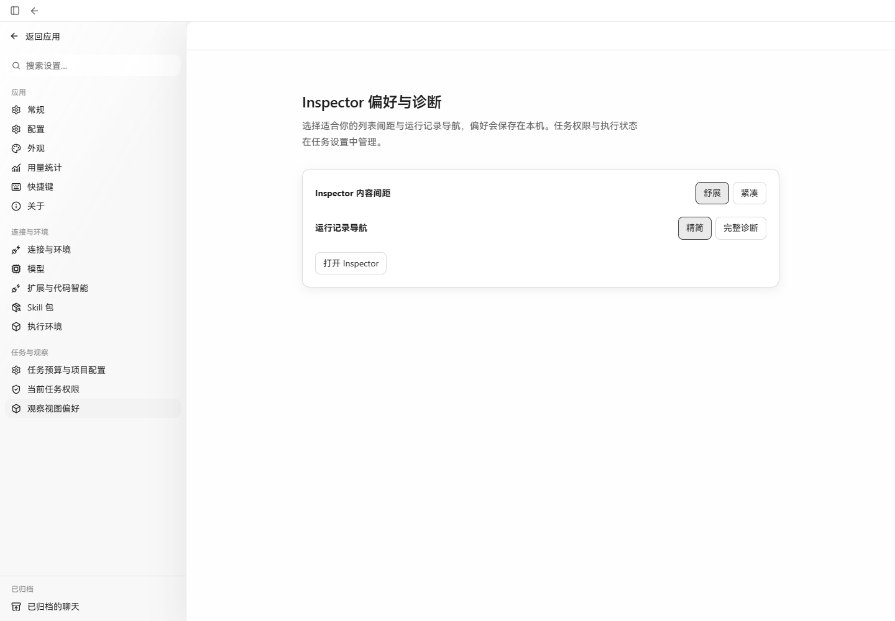
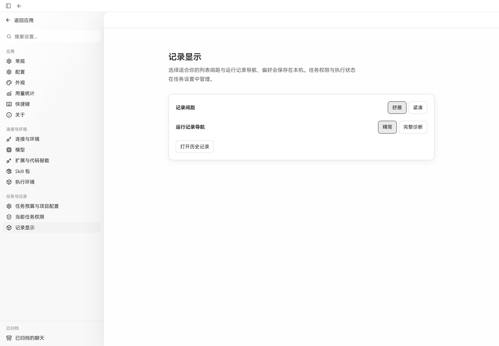
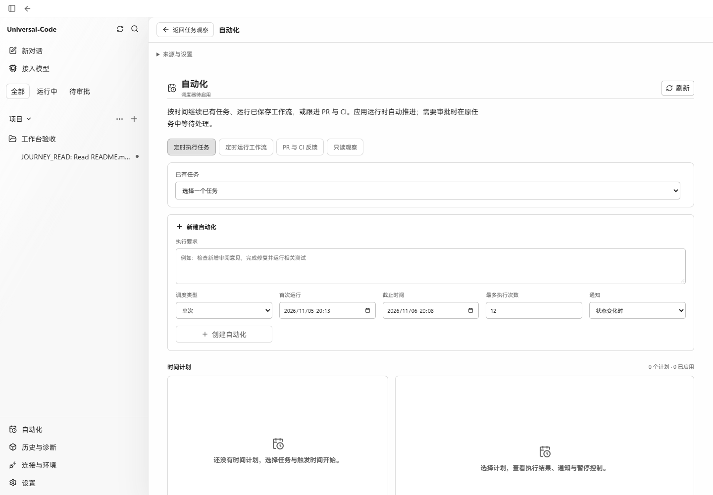
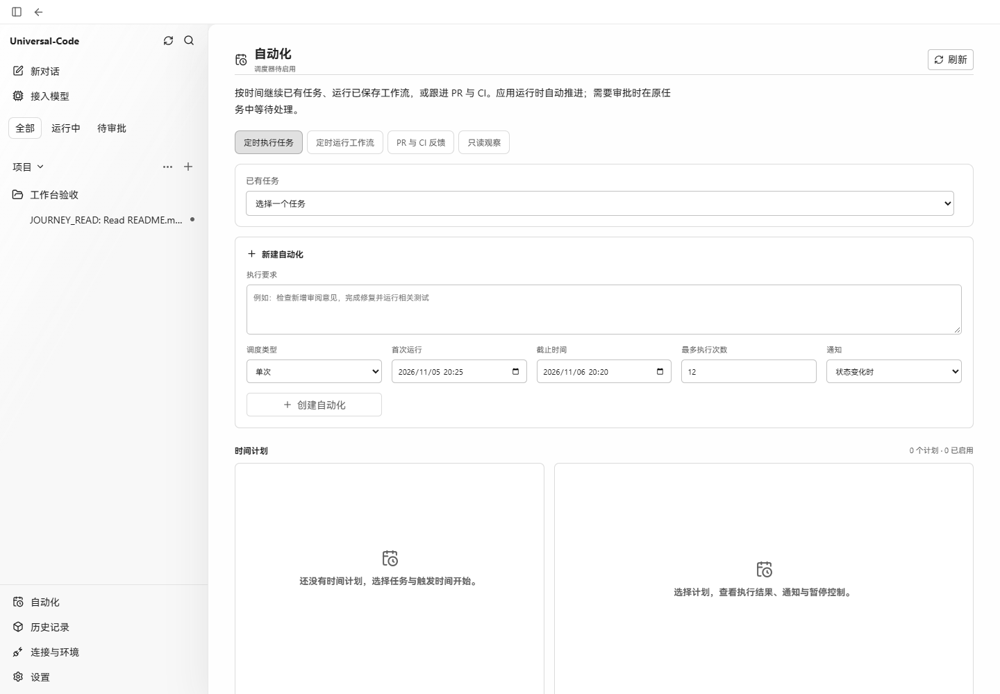

# Inspector removal — browser evidence

Captured on Windows in Chrome, Chinese locale, light appearance, at 1440 × 1000.

- Before: main `4082ce9dd3677ed01ef828cf12137bd2235b9b6c`.
- After: source `024a120d44b629ccfcba69748abb6f88d8883813`.
- Both production UI builds connect to the same local Go journey harness and SQLite task. The offline model previously completed a real `workspace_read` of `README.md`; neither API responses nor rendered DOM were replaced for these captures.
- The task is a disposable verification fixture named “工作台验收”. Screenshots contain no credentials or local workspace paths.

| Page | Before | After |
| --- | --- | --- |
| History |  |  |
| Record preferences |  |  |
| Automations |  |  |

The final build was also exercised in the browser: task execution records keep the composer visible; Run details preserve their source task and return through settings to the exact resource; at 390 × 844 the records dialog fits the viewport and Escape preserves the draft; old Inspector hashes render an invalid-address state; global history opens an unbound Run and returns to the original task without cycling through the Run again.

Focused route, page, settings, notification and record regressions passed, as did TypeScript/Vite, API schema checks, Go WebUI and safe-projection tests, Windows desktop tests, and the Windows production executable build. CI results are recorded in the PR.
