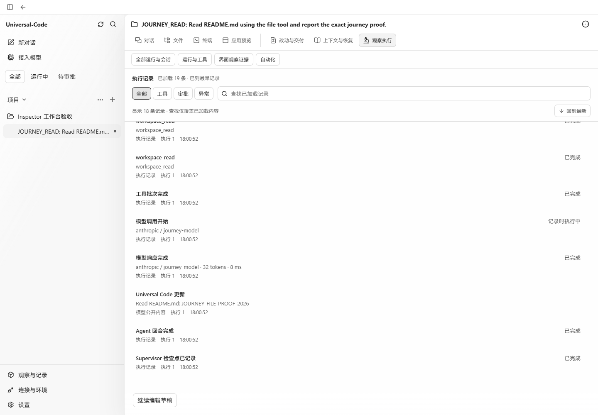
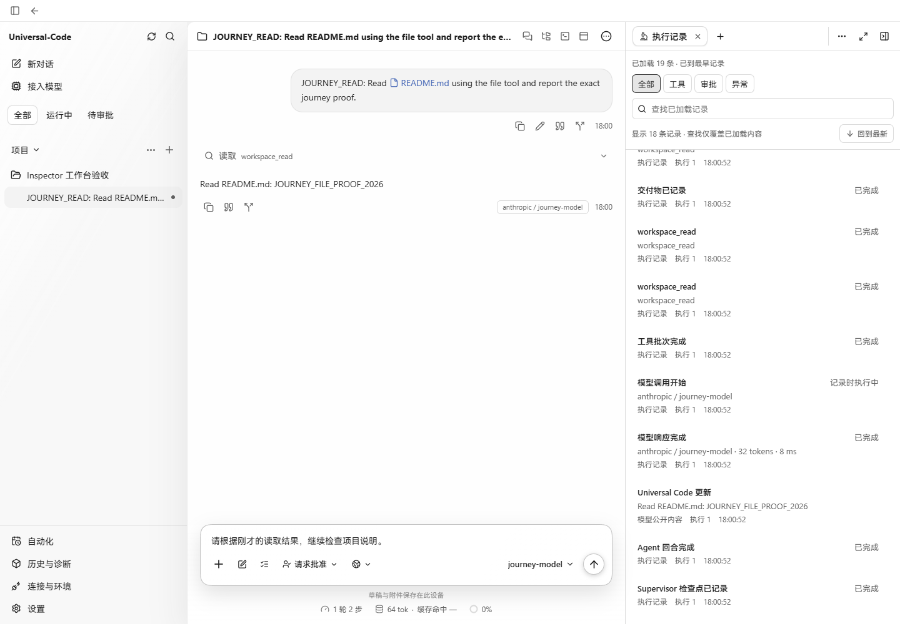
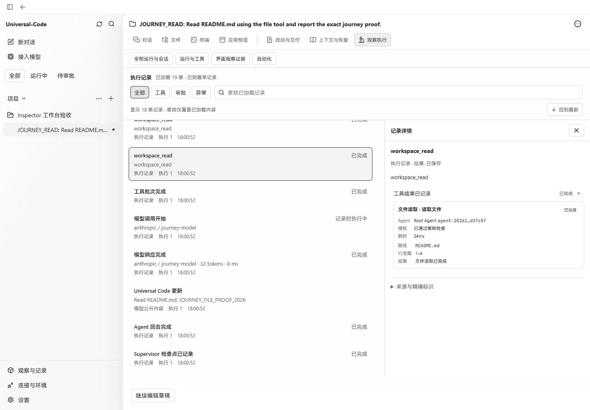
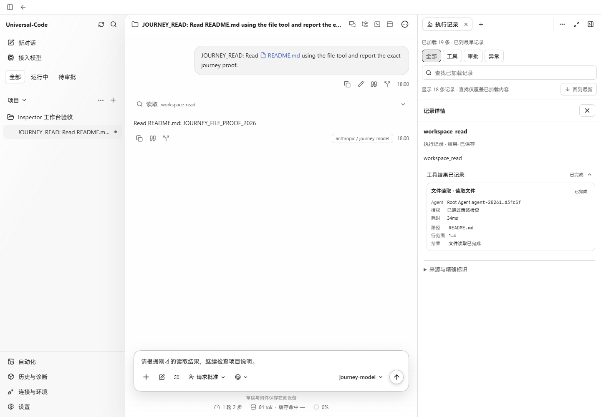
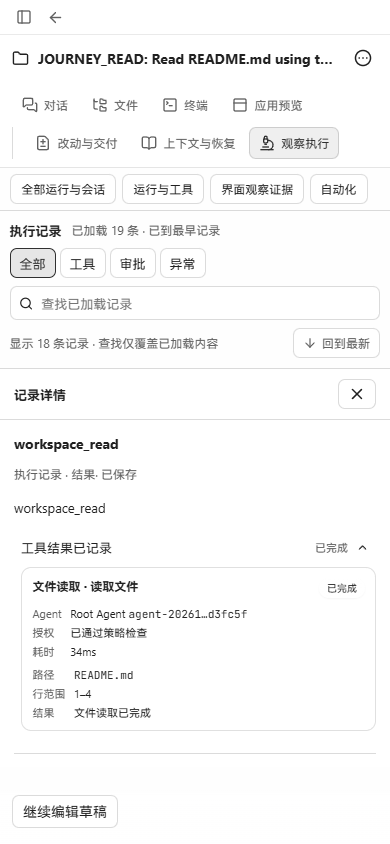
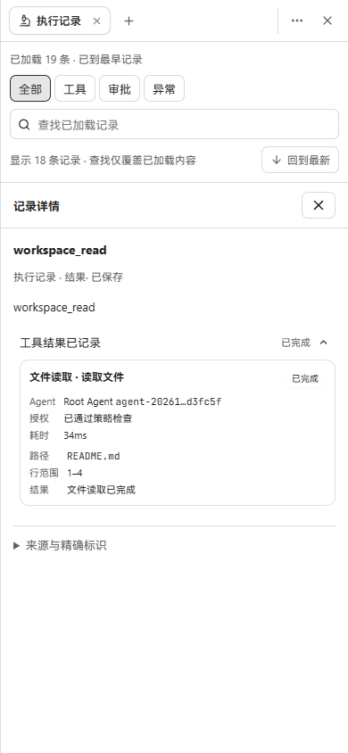

# 任务内执行记录验收

打开执行记录后，宽屏保留聊天正文和输入框，在工作台标签中查看记录与工具详情。运行与工具、界面证据收进标题栏的“…”菜单，移除常驻二级诊断栏。窄屏使用现有工作台弹层，关闭后回到原任务和草稿。跨任务的运行、会话记录保留在“历史与诊断”，自动化使用独立侧栏入口。

## 截图来源

- 修改前：`fabee9b8c792ffec7327a0630e24b8033b7386c2`。
- 修改后：`6161da1e610a8e79cf134dc26c03a454501d63de`。
- Windows、Chromium、中文、浅色主题；宽屏 1440 × 1000，窄屏 390 × 844。
- 两个版本均通过 `npm run build` 构建。使用仓库原有 `cmd/workbenchjourney` 启动真实 Go API、临时 SQLite 和临时 Git 项目；模型使用该验收工具内置的离线响应。
- 在页面中接入项目并发送 `JOURNEY_READ` 请求，真实 `workspace_read` 读取 README.md。两个前端连接同一 API，展示同一个任务、同一份工具记录，并输入相同的未发送草稿。
- PNG 由 Playwright 直接截取，未修改页面 DOM、替换 API 响应或加工图片。令牌、服务日志和临时数据库保留在本地，未提交。

| 场景 | 修改前 | 修改后 |
| --- | --- | --- |
| 宽屏执行记录 |  |  |
| 宽屏工具详情 |  |  |
| 窄屏工具详情 |  |  |

## 已验证行为

- 打开记录、选择工具详情时，宽屏聊天和未发送草稿仍可见。
- 窄屏 Esc 先关闭选中详情，再关闭工作台；焦点回到对话操作按钮，草稿保持原文，页面没有横向溢出。
- 标题栏菜单可独立通过 Esc 关闭；点击聊天输入框关闭菜单时保留输入框焦点。菜单之间互斥的键盘路径也有组件回归覆盖。
- 宽屏切换至窄屏后，焦点回到可见入口；完整视图仍可打开和退出。
- 旧任务 `/inspector` 链接打开任务内记录；运行与工具入口保留原运行 ID。
- “历史与诊断”和“自动化”分别打开全局页面；重新选择任务回到普通任务路由并保留草稿。
- 组件回归测试覆盖图片弹窗优先处理 Esc、记录分页保留聊天阅读位置、文件未提交修改拦截、每任务独立标签、共用聊天记录读取以及精确运行/会话/恢复链接。

验证命令包括 `npm run build`、`npm run check:api`，以及相关 Vitest 测试。三组交互回归（Inspector、conversation-inspector-feedback、conversation）83 项通过；四组导航回归（app、navigation、workspace-tabs、inspector-tools-navigation）85 项通过；lazy、lazy-error、shell-submission 三组测试通过。最终菜单互斥修复后，13 项 conversation-inspector-feedback 测试再次通过。
