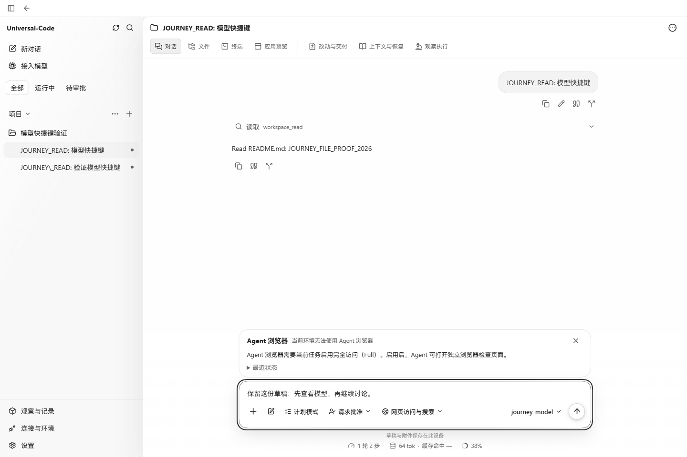
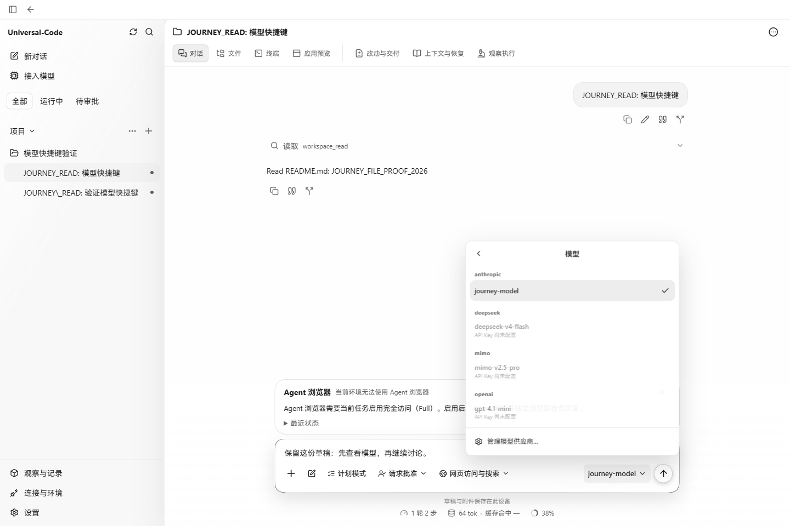
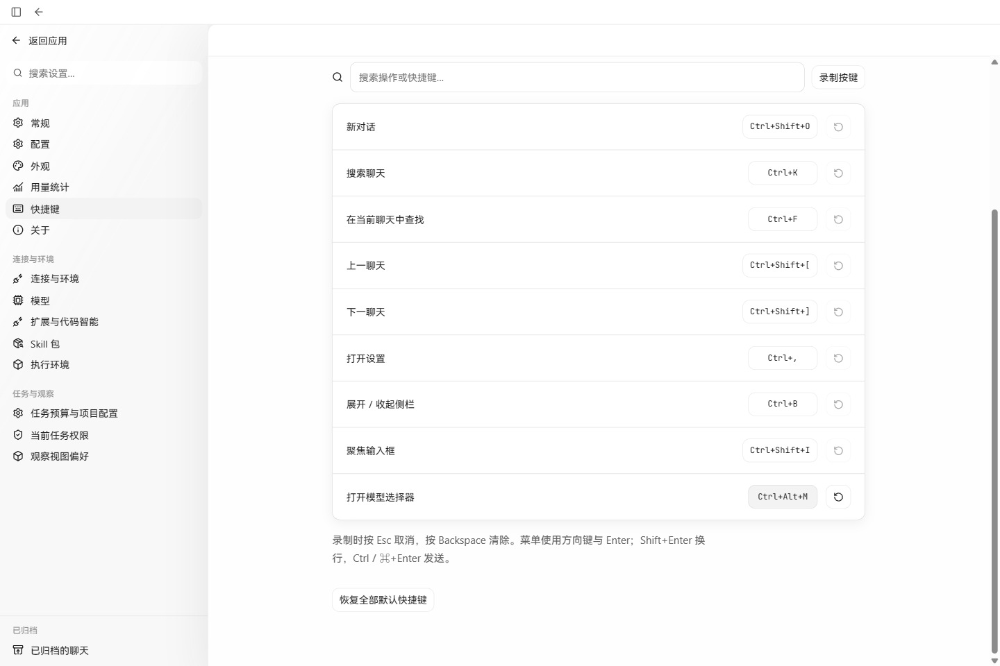
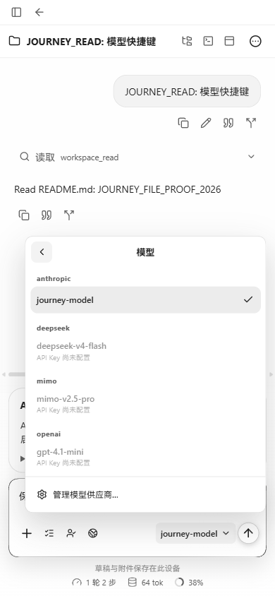

# 模型选择快捷键验证

默认 `Ctrl/⌘+Shift+M` 从当前聊天输入框直接打开模型列表。设置的“打开模型选择器 / Open model picker”支持录制、清除和恢复默认。打开列表不选择模型；仍使用原有可用性检查、禁用状态、方向键和 Esc 焦点恢复。

基线为 `cace352a4b6515b211b826be598ca8f0fbded440`。前图使用修改前保留的 `.tmp/before-dist`（入口 `index-BqRcF9xq.js`），后图使用本次 `npm run build` 的 `web/dist`（入口 `index-CmAroUUm.js`）。两者由 Vite preview 在同一地址 `127.0.0.1:53872` 提供生产静态文件，API 始终代理到同一个真实 Go 服务 `127.0.0.1:53837`。没有改写 API 响应或页面内容。

## 真实浏览器结果

2026-10-22，Windows Chrome 155.0.0.0；桌面视口为 1440×960。

使用本分支 `cmd/workbenchjourney` 编译的真实 API、临时 SQLite/项目与离线 provider。保存聊天 `thread-run-20261021214544-e651a6ee4baf` 的发送返回 HTTP 202，实际读取 README.md 并保存回复 `Read README.md: JOURNEY_FILE_PROOF_2026`。前后保持同一聊天和草稿 `保留这份草稿：先查看模型，再继续讨论。`。

| 操作 | 实际结果 |
| --- | --- |
| 原版纯文本输入按 Ctrl+Shift+M | 没有应用菜单，草稿保持原样。 |
| 新版相同位置按 Ctrl+Shift+M | 直接出现“选择模型路由”，焦点位于原有“返回模型设置”按钮。 |
| 打开、关闭模型列表 | 仅新增 `GET /api/v1/models/routes/available`，返回 HTTP 200；无模型路由写请求。当前 anthropic / journey-model 保持选中，未配置凭据的模型保持禁用。 |
| 设置中录制 Ctrl+Alt+M | 保存 `modelPicker: Mod+Alt+M`；录制和设置页面都没有打开模型菜单。 |
| 返回聊天，使用旧键、新键 | 旧键不再打开；Ctrl+Alt+M 打开列表，草稿仍逐字相同。恢复默认后 Ctrl+Shift+M 再次有效。 |
| Markdown 输入，390×844 | 默认键打开列表；正文保持相同，Esc 关闭列表。菜单 x=35.33、宽=342、右缘=377.33，在视口内。 |

窄屏外层 document/body 的 clientWidth/scrollWidth 均为 390。此基线的聊天记录区域仍有既有横向滚动条：`.v2-conversation-scroll` 为 390/448，关闭模型列表后仍然存在；用户消息 tooltip 仍使用原 `left: 0` 样式。本次未改动该样式。

初次准备数据时，Markdown 模式将 harness 标记 `JOURNEY_READ` 序列化为带转义字符的文本，该次请求返回 412，未作为成功记录。随后以纯文本发送同一 harness 指令取得上述真实 202 和保存回复。截图侧栏保留该次失败聊天。

## 截图

前后图使用同一 API、保存聊天、草稿及 1440×960 视口。

## 聚焦验证

`npm test -- src/v2/components/model-route-control.test.tsx src/v2/components/keyboard-settings.test.tsx`：35 项通过。

新增用例覆盖 Ctrl/Meta 默认键、直接列表/只读打开、草稿和焦点、禁用模型、改键/清除/持久化、旧自定义键冲突、无局部处理器时不 preventDefault、权限不足，以及 IME、重复按键、录制、弹窗、其他菜单、Monaco 和终端保护。`npm run build` 通过；`git diff --check` 通过。

实际浏览器覆盖 Windows Ctrl、设置改键、纯文本与 Markdown。Meta 只做组件事件验证，未声称 macOS 实机验证。

参考：[官方命令页](https://learn.chatgpt.com/docs/reference/commands)列出 Open model picker：Windows/Linux 为 Ctrl+Shift+M，macOS 当前列为 Control+Shift+M。本应用沿用现有 Mod 规则，接受 Ctrl 或 Meta；设置在 macOS 显示 ⌘。
