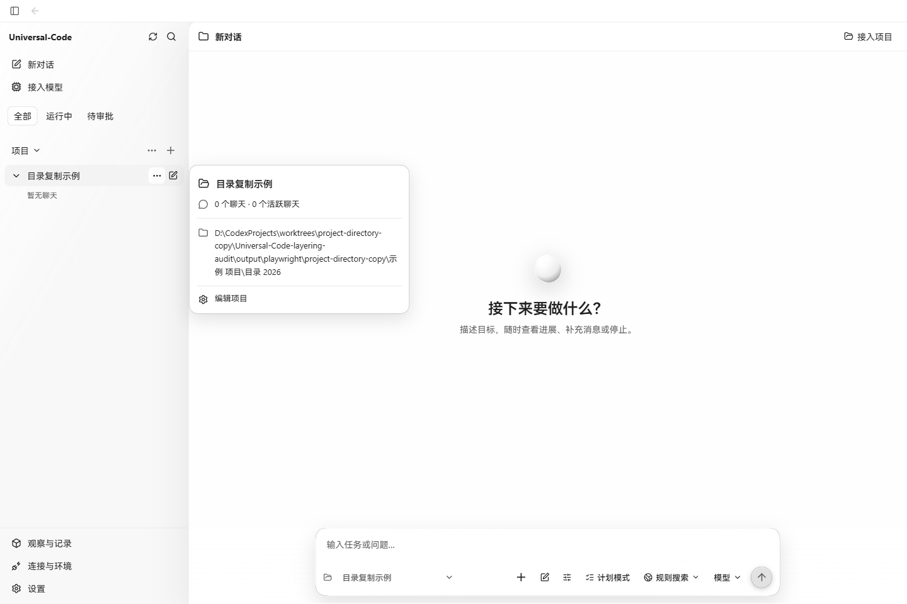
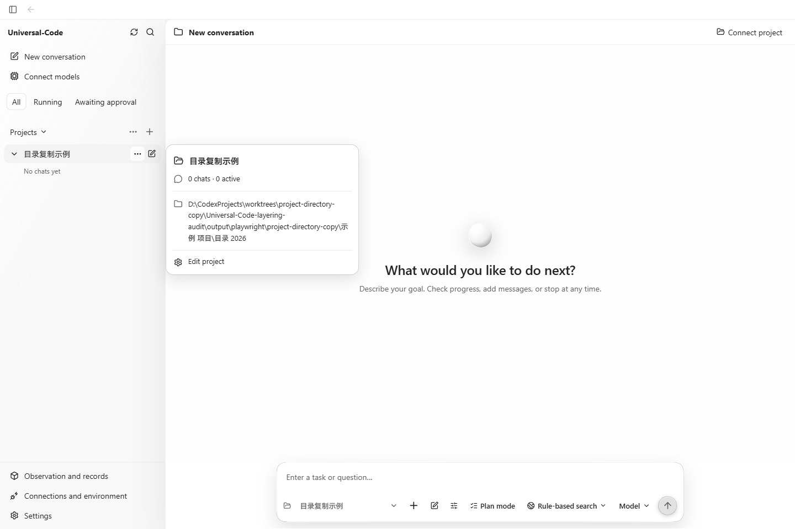
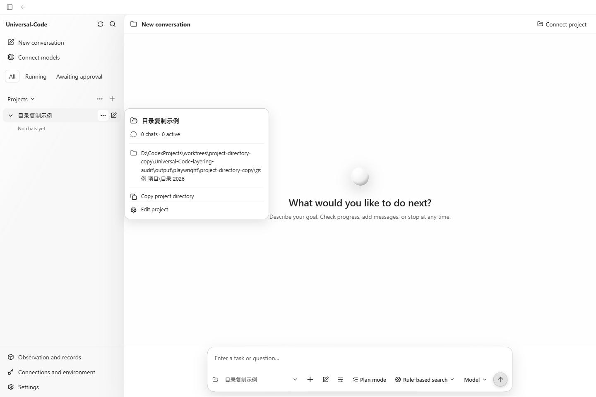
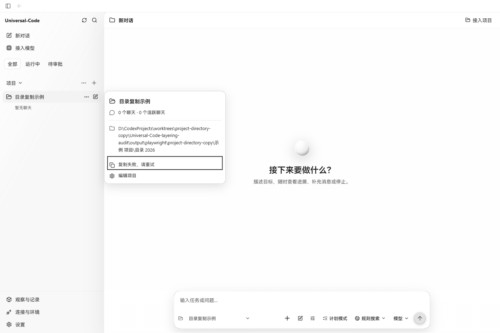

# 项目目录复制验收

项目详情卡增加“复制项目目录 / Copy project directory”。按钮复制详情接口返回的完整 `directory_path`，沿用“编辑项目”按钮样式，成功与失败反馈直接显示在复制按钮中。原目录文本仍可选中。

## 真实页面来源

- 改前：`fc0935d6fc03ca7abccbd148ce52d26c2bc154f8` 原始生产构建。
- 改后：同一基点上仅修改 `project-header.tsx` 与对应测试后的生产构建，没有修改样式。
- Windows 上的 Chrome 155.0.8059.85，有界面运行，通过 Playwright CLI 操作；所有截图为 1440 × 960、浅色主题。
- 改前由现有 `cmd/workbenchjourney` 启动真实生产 API 和原始 bundle；改后由 Vite preview 提供生产 bundle，API 请求代理到同一个服务。同一个项目由创建项目界面导入，名称、目录、聊天数及视口保持一致。
- 项目目录为本次验收创建的真实目录，含中文和空格，长度 134 个字符。未替换页面 DOM、剪贴板实现或 API 响应。

## 结果

- 中文界面：从项目详情卡的“编辑项目”按钮按 Shift+Tab 到复制按钮，Enter 复制；实际读取系统剪贴板，与完整目录逐字一致。
- 中英文拒绝场景：在同一浏览器上下文通过 CDP 设置真实剪贴板权限为 denied，并保持该 CDP 会话连接，点击复制后分别显示“复制失败，请重试”和“Copy failed. Try again”。恢复读取权限后确认剪贴板仍是操作前写入的测试标记，没有被失败的复制改变。
- 完整目录在成功、失败时均保留。按钮保持可访问名称，并提供 `role="status"` 反馈。Escape 返回项目详情触发按钮的焦点。
- 单元测试覆盖中英文键盘操作、中文/空格路径原样复制、剪贴板拒绝后重试、关闭再打开时状态重置，以及未取得项目详情时不显示复制按钮。
- `npm test -- src/v2/components/project-header.test.tsx`：5 个测试通过；`npm run build` 和 `git diff --check` 通过。
- 浏览器覆盖为上述 Windows Chrome；未执行原生桌面 WebView 或 macOS 验收。

## 截图

| 界面 | 改前 | 改后 |
| --- | --- | --- |
| 中文 |  |  |
| English |  |  |

