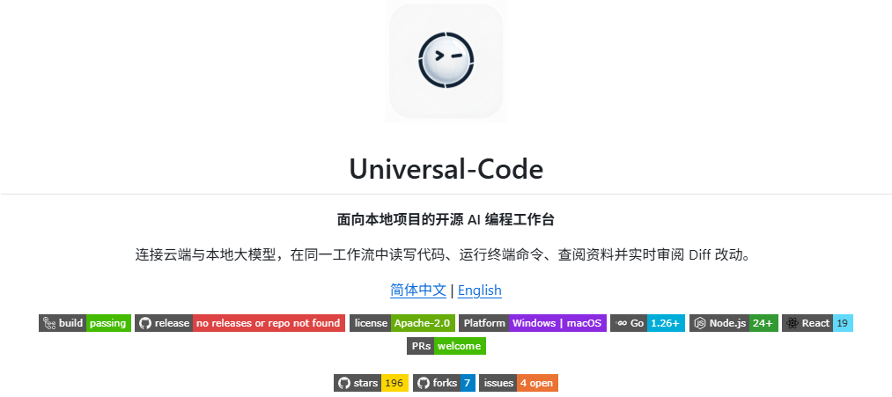
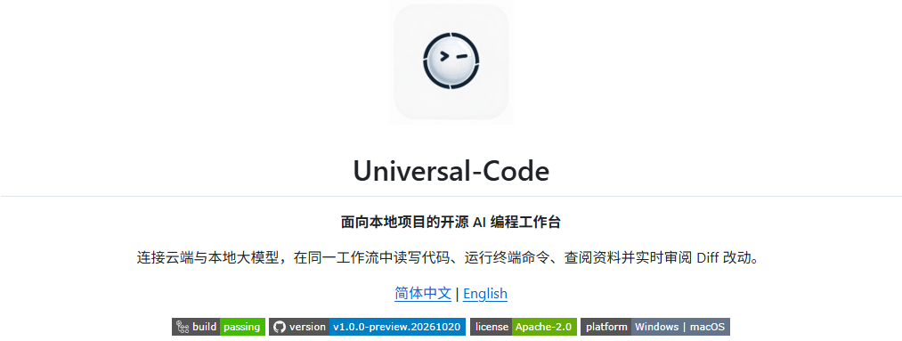

# README badge comparison

Captured from GitHub's rendered Chinese README in Chrome with a 1440 × 1000 viewport and light appearance. Each PNG is an unscaled element screenshot of the README header, including the logo, introduction and badges.

- Before: `9a0b73b01b206076e4e9af4c608b8696f605a1d5`.
- After: `57d9c867b1d1403e83ff653c24bd36d302836624`.
- All four retained badge endpoints returned HTTP 200. The version badge returned `v1.0.0-preview.20261020`.
- The platform badge's Chinese download anchor was clicked on GitHub and verified. Both language-specific targets match their README download headings.

| Before | After |
| --- | --- |
|  |  |
