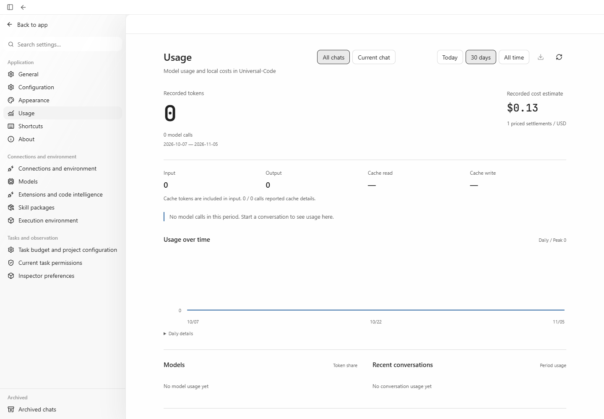
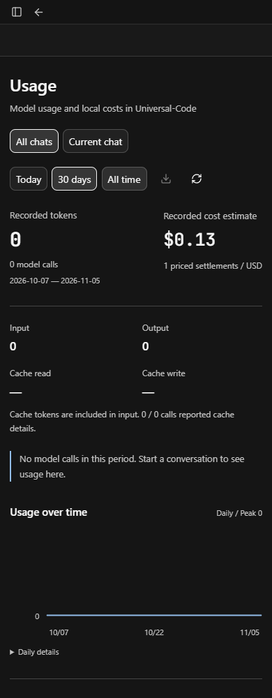
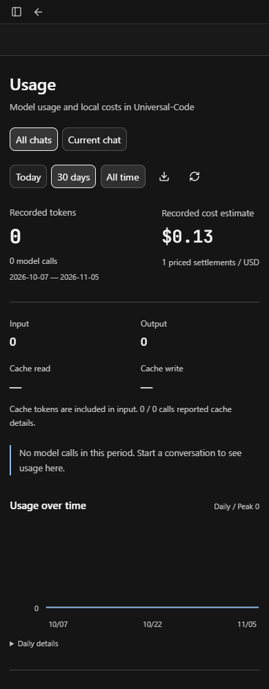

# Cost-only usage CSV export (2026-11-05)

The Usage panel can show costs in a period with no completed model calls because
costs use settlement time. Export now remains available when any priced,
unpriced, or untracked cost facts exist, including explicitly priced zero cost.
Loading, refreshing, and a genuinely empty period still disable export.

| Before: disabled despite a recorded cost | After: export enabled for the same data |
| --- | --- |
|  |  |
|  |  |

All four PNGs are unmodified browser viewport screenshots, without cropping or
resizing. They were visually inspected at their original aspect ratios. The
enabled export icon is visible beside Refresh in both layouts.

## Source and data provenance

- Before: production frontend built from PR #530 head
  `81ceefbbbdbdcc3c3921d333e1526aea02dd849e`.
- After: production frontend source in
  `758eb9e6e04dfb0b933e06024e5fe6925feab524`.
- Windows, headless Chrome 156 driven with Playwright CLI, Node 24.14.0,
  Go 1.26.10, English UI, UTC+08:00.
  Light viewport: 1440 × 1000. Dark viewport: 390 × 1000.
- Both frontends connect to the **same running production Go API and SQLite**,
  started by the repository's unmodified `cmd/workbenchjourney` harness. Before
  is served directly by that API; after is served by Vite preview with `/api`
  proxied to it.
- The data is a **deterministic local fixture**, created with the production
  `RunService.Create`, `ReserveModelCost`, and `SettleModelCost` methods by
  [seed-cost-only.go.txt](seed-cost-only.go.txt). It reserves USD 0.25 and settles
  USD 0.125 as priced, without a terminal model receipt. No model request is
  made. This exercises the cost-only projection; it does not replay an actual
  provider call completed in an earlier period.
- `GET /api/v1/usage?period=30d&utc_offset_minutes=480` returns calls=0,
  known_cost_micros=125000, priced_calls=1, unpriced_calls=0, untracked_calls=0.
  [usage-response.json](usage-response.json) records the real response data.
  Before/after projections were compared and were identical apart from
  `generated_at`. Browser HTTP responses, page content, and styles were not
  replaced.
- Clicking Export in the fixed real UI downloaded
  `universal-code-usage-30d-2026-10-07_2026-11-05.csv`.
  [cost-only.csv](cost-only.csv) is that download: UTF-8 BOM, 21 columns,
  a header and one totals row with calls=0 and known_cost_usd=0.125000.

## Reproduction commands

Run from the repository root in an isolated checkout. Build the before frontend
at the baseline commit, then preserve `web/dist` before applying the fix:

```powershell
git switch --detach 81ceefbbbdbdcc3c3921d333e1526aea02dd849e
Set-Location web
npm ci
npm run build
Set-Location ..
New-Item -ItemType Directory output/playwright/usage-cost-only -Force
Copy-Item web/dist output/playwright/usage-cost-only/before-dist -Recurse
go build -tags workbenchjourney -o output/playwright/usage-cost-only/workbenchjourney.exe ./cmd/workbenchjourney
./output/playwright/usage-cost-only/workbenchjourney.exe --ui-dir output/playwright/usage-cost-only/before-dist
```

Keep the harness running with stdin open in a separate terminal. Its
`journey_metadata` line supplies `temp_root` and local access tokens; its
`api_url` supplies the API address. Save that metadata to an untracked
`output/playwright/usage-cost-only/private-state.json` (never publish tokens).
Then seed once, build the fixed source, and serve it against the same API:

```powershell
git switch --detach 4f624d01bb848d2a74bb22cf9d60681f9c1cfe57
New-Item -ItemType Directory output/playwright/usage-cost-only/seed -Force
Copy-Item docs/evidence/usage-export-cost-only/seed-cost-only.go.txt output/playwright/usage-cost-only/seed/main.go
go run ./output/playwright/usage-cost-only/seed ./output/playwright/usage-cost-only/private-state.json
Set-Location web
npm run build
$env:CYBERAGENT_API_TARGET = '<harness origin, without /api/v1>'
npm run preview -- --port 4530 --strictPort
```

Use `npx --yes --package @playwright/cli playwright-cli --session pr530 open
<origin> --browser chrome`, connect with the harness tokens, and navigate through
Settings → General → English, Appearance → Light/Dark, and Usage. Resize with
`resize 1440 1000` or `resize 390 1000`; capture with `screenshot --filename
<path>`. The four images use All chats / 30 days and the top scroll position.

## Verification and review

- `npm test -- src/v2/components/usage-settings.test.tsx`: 20 tests passed,
  covering cost-only priced/nonzero, priced/zero, unpriced and untracked facts,
  empty/loading/refresh guards, and existing CSV escaping/formula safety cases.
- `npm run typecheck`: passed. `npm run build`: passed for both production
  bundles; Vite reported its existing large-chunk warning.
- Actual browser download parsed with Python's CSV reader: BOM present, both
  rows have 21 fields, cost and call values match the real API projection.
- OCR Delegate supplied file selection and TypeScript rules. The host reviewed
  the full component and test file, plus `usage-export.ts` and the backend
  settlement-counting path. Tests excluded by OCR's default filter were read
  explicitly. No additional findings. The evidence README, seed helper, JSON,
  and CSV were read in full; all four binary PNGs were visually inspected.
  Final OCR selection: 3 reviewable files, 3 reviewed, 0 skipped (100%);
  all 8 filter exclusions were inspected separately. The local `.gitattributes`
  was also read in full and preserves the original CSV download bytes.
- Spreadsheet application import was not rerun for this follow-up.
