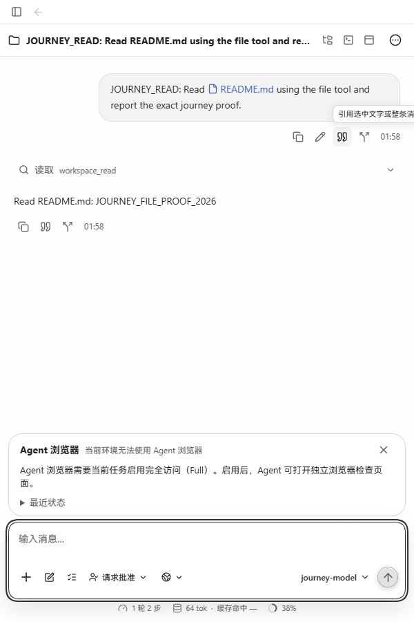
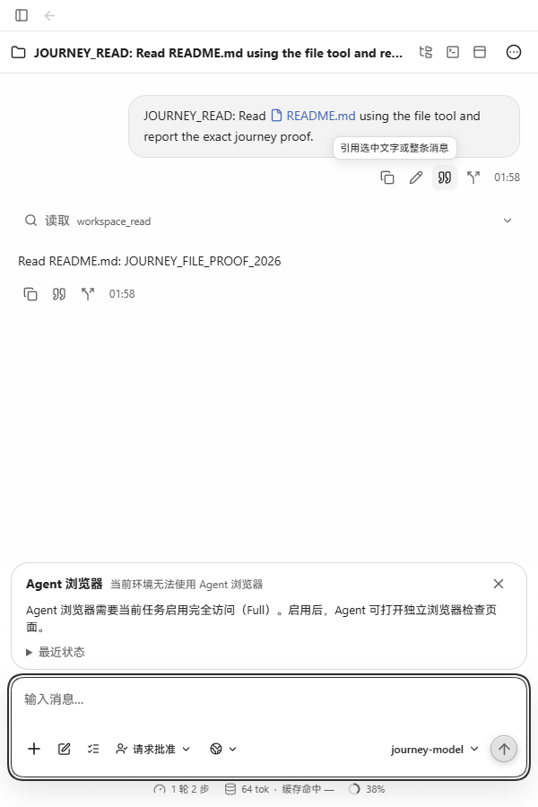
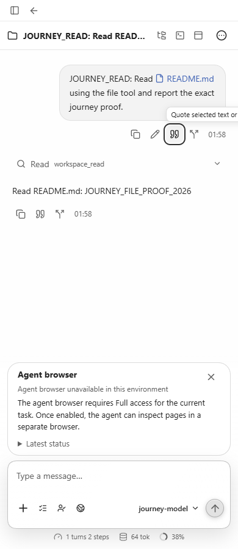
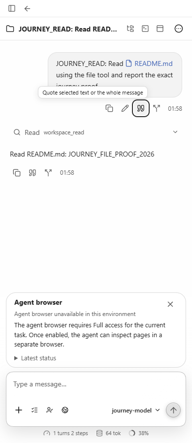
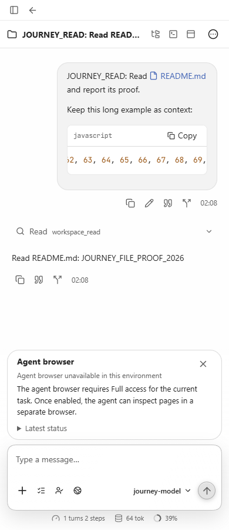

# 消息操作提示的窄屏边界

用户消息位于聊天右侧，操作提示原来从按钮左边向右展开。即使提示处于 `visibility: hidden`，其宽度仍扩大聊天滚动区域；鼠标悬停或键盘聚焦时，提示末尾被裁掉。

本次仅将 `.v2-user-actions .v2-assistant-action-tooltip` 改为 `left: auto; right: 0`，让用户消息提示向左展开。助手消息提示保留原有对齐方式。

## 真实页面对照

2026-10-22，Windows Edge。修改前使用 #439 / `ef6ae6b1` 的现成生产 bundle，修改后使用本工作树的生产构建。两套页面连接同一份 SQLite 中已保存的对话，使用生产 API；对话由 `cmd/workbenchjourney` 离线模型提供者实际读取 README 后生成。未替换 DOM、注入修复样式或拦截接口制造结果。

600px 中文，鼠标悬停“引用消息”：

| 修改前 | 修改后 |
| --- | --- |
|  |  |

390px 英文，使用 Tab 聚焦“Quote message”：

| 修改前 | 修改后 |
| --- | --- |
|  |  |

## 尺寸与滚动检查

以下各组都检查了初始隐藏状态，以及四个用户操作按钮逐一悬停、逐一键盘聚焦。修改后所有消息提示均位于聊天容器左右边界内。

| 语言 / 视口宽度 | 聊天 clientWidth | 修改前 scrollWidth | 修改后 scrollWidth |
| --- | ---: | ---: | ---: |
| 中文 / 600px | 600 | 621 | 600 |
| 中文 / 390px | 390 | 411 | 390 |
| English / 600px | 600 | 704 | 600 |
| English / 390px | 390 | 494 | 390 |

[完整 DOM 尺寸记录](measurements.csv)包含每次测量的提示边界、可见状态和透明度。基线生产 bundle 摘要为 `ecb366bd9e5d692d8dedc260669f3ac456b31113ca1565b50b400add6f97752b`，修改后为 `ddca30555373a91473dd60bb522246d39fc0b39c5f3a023bafe0a216bfbdd945`。

另从真实输入框发送并保存了带长行的 JavaScript 代码块。代码区域的 `scrollWidth` 为 2570px，在 600px / 390px 视口下自身宽度分别为 401px / 237px。横向滚轮将代码自身的 `scrollLeft` 分别推进至 1200px / 2000px；聊天容器保持 `scrollLeft=0`，且 `scrollWidth=clientWidth`。完整代码原文保留。[滚动测量](code-scroll.json)

`npm run build` 通过。以上为生产网页验证，未作为原生打包窗口验证。
