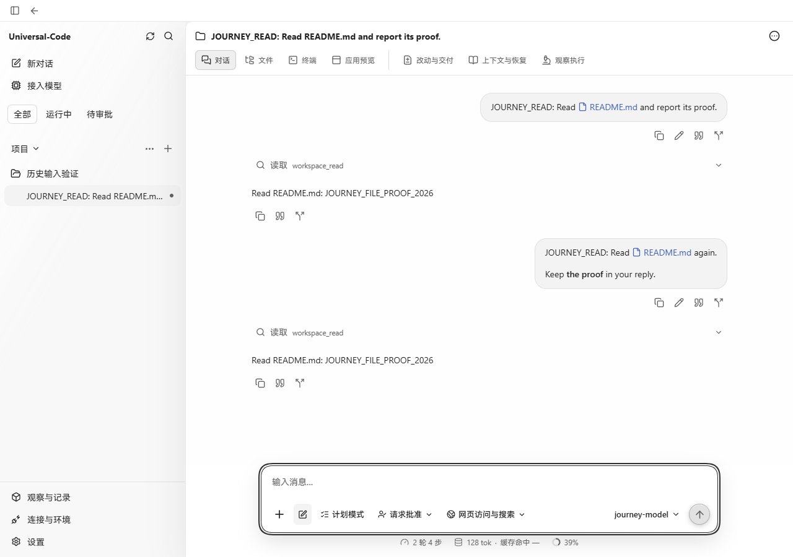
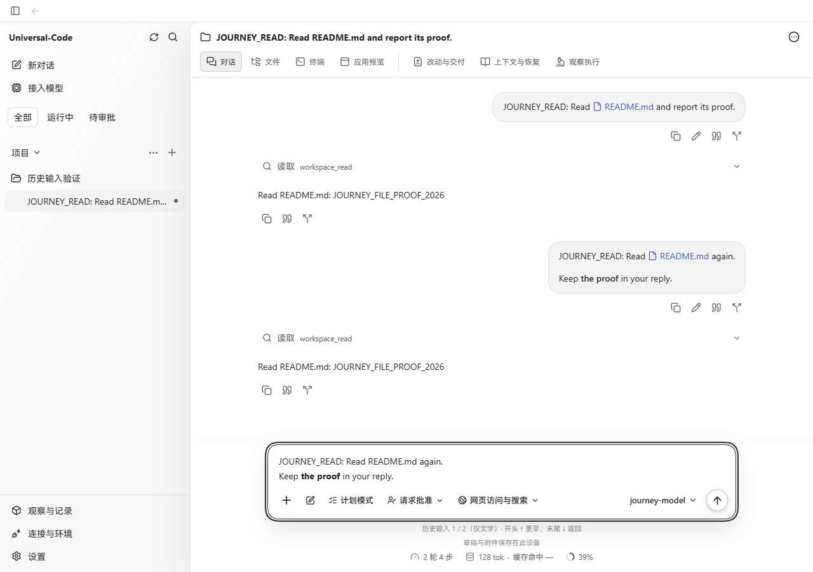
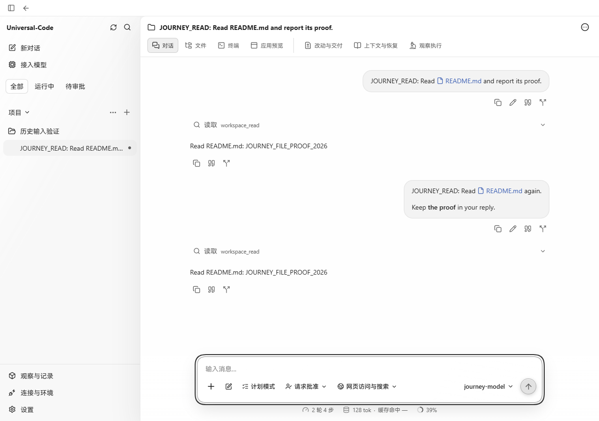
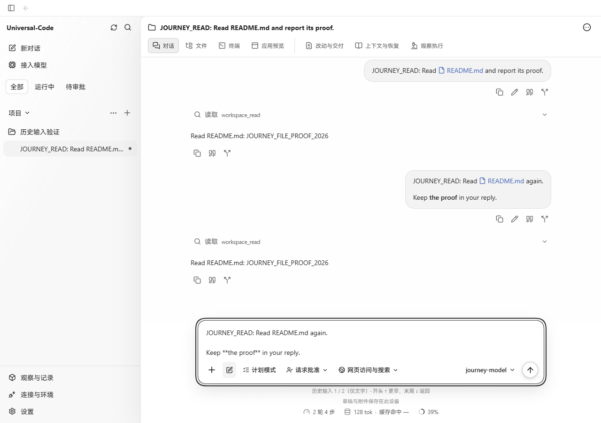

# 当前聊天的输入历史

在空输入框按 ↑，可回填当前聊天最近一条已发送的文字。浏览历史时，把光标移到全文开头再按 ↑ 可取更早输入；在全文末尾按 ↓ 可取较新输入，越过最新一条后返回原来的空草稿。富文本与纯文本编辑器使用相同规则，回填保留原始 Markdown。

手工编辑后退出历史浏览。中文输入法组合、带修饰键的方向键、选区和正文中间的光标移动仍由编辑器处理。输入已有文字、附件或文件/MCP 引用时，不进入历史浏览；回填只复制文字，不重新加入旧附件。正在读取时若编辑、加入附件、切换聊天、移动选区或失去输入焦点，旧请求不会覆盖草稿。

历史索引逐页读取公开 transcript，并沿用公开消息投影排序与过滤；只包含已保存的用户输入，排除待发送、撤回、内部与临时消息。选中某条历史后再读取其完整已保存正文，因此不受当前聊天窗口页数及预览截断影响。索引或正文读取失败会显示错误并保留草稿，可以再次按 ↑ 重试。

## 真实页面验证

2026-10-22，Windows Edge，1280 × 900，生产前端、生产 API 和 SQLite。基线为 `96ba29bf`。通过 `cmd/workbenchjourney` 的离线模型提供者，从界面发送两条真实请求并读取 README；前后页面使用同一份已保存的对话。历史请求使用真实公开 API，截图未替换页面或接口内容。

| 富文本：修改前，空输入按 ↑ | 富文本：修改后，空输入按 ↑ |
| --- | --- |
|  |  |

| 纯文本：修改前，空输入按 ↑ | 纯文本：修改后，空输入按 ↑ |
| --- | --- |
|  |  |

浏览器实际验证了两种编辑器的首次回填、更早/更新浏览和返回空草稿，以及手工输入保留、多行光标与选区保护。富文本回填中的粗体正常渲染，切换到纯文本后仍保留 `**the proof**` 原文。以上为生产网页验证；未作为原生打包窗口验证。

## 自动检查

- `npm test -- src/v2/use-prompt-history.test.tsx src/v2/components/composer-history.test.tsx src/v2/components/markdown-input.test.tsx src/v2/components/composer.test.tsx src/v2/components/composer-attachment-settlement.test.tsx`：46 个测试通过。覆盖跨页顺序、长正文、公开消息过滤、分页/正文失败、延迟请求保护、富文本与纯文本、IME、选区、正文光标、手工编辑、附件/引用及现有发送行为。
- `npm run build`：通过。
- `go build -o output/playwright/prompt-history/cyberagent-after.exe ./cmd/cyberagent`：通过，用于真实 API 页面验证。

## 与项目路径补全和 Esc 停止的组合验证

在原输入历史提交 `c2b6200e` 中合入路径补全提交 `8e5de069` 后，两个编辑器都先让路径候选处理按键，再处理输入历史，最后处理发送。合并只涉及 `composer.tsx` 和 `markdown-input.tsx` 的真实冲突。

组合回归先复现了富文本问题：回填含 `@R` 的历史正文时，`setContent` 的选区回调早于正文身份更新，生成的候选持有旧正文，随后 Enter 被草稿校验拒绝。恢复外部草稿期间现在复用 `replacing` 标记抑制该回调；用户后续移动光标或编辑时按当前正文生成候选。

2026-10-22，Windows Chrome 155，1280 × 900。使用本树生产构建、生产 API、SQLite 和 `cmd/workbenchjourney` 离线提供者。实际发送 `JOURNEY_READ: 请读取 README @R`，服务返回 HTTP 202，工具读取真实 README 并保存回复；随后在两种编辑模式中从空输入按 ↑ 回填这条消息。原四张前后截图保持原样，本次追加以下组合截图：

| 行为 | 真实截图 |
| --- | --- |
| 纯文本从空输入回填历史 | [回填](images/prompt-history/combined-plain-history.png) |
| 纯文本候选 ↑↓ / Enter 加入真实 README 引用 | [选择文件](images/prompt-history/combined-plain-selection.png) |
| 富文本从空输入回填历史 | [回填](images/prompt-history/combined-rich-history.png) |
| 富文本候选 ↑↓ / Enter 加入真实 README 引用 | [选择文件](images/prompt-history/combined-rich-selection.png) |
| Esc 关闭候选、保留原草稿 | [关闭列表](images/prompt-history/combined-escape-closes-list.png) |
| 运行中 Esc 停止并保留草稿 | [执行已停止](images/prompt-history/combined-escape-stops-run.png) |

富文本候选操作前后正文分别为 `JOURNEY_READ: 请读取 README @R` 与 `JOURNEY_READ: 请读取 README @README.md `；↑↓ 没有改变正文，候选操作期间新增历史正文请求为 0。选择文件后出现真实引用芯片，没有提交新消息。

关闭候选时记录到 0 个 POST 请求，草稿仍为 `关闭候选后保留草稿 @R`。另一次真实运行中按 Esc 后，`POST /threads/{id}/interrupt` 返回 HTTP 202、状态 `stopping`，后续真实执行查询返回 HTTP 200、状态 `idle`；草稿仍为 `停止后保留的草稿`。

生产页面沿用原有限制：模型正在执行时禁止新增项目文件引用，因此运行中的停止按钮与路径候选不会同时可用。浏览器分别验证上述两个真实状态；两种编辑模式的 Composer 集成测试验证“第一次 Esc 关闭列表、第二次 Esc 调用停止”，且引用和草稿不变。未修改执行期文件引用限制。

组合检查通过：以下 8 个测试文件共 87 项、`npm run build` 和 `git diff --check`。生产 bundle 摘要为 `b63d9a403439ff619ec436d02e96ff555a12d93af61c76f7481a5fe95971c710`。浏览器覆盖 Windows Chrome，未运行原生打包窗口。

```sh
cd web
npx vitest run src/v2/use-prompt-history.test.tsx src/v2/components/composer-history.test.tsx src/v2/components/markdown-input.test.tsx src/v2/components/file-path-mention.test.ts src/v2/components/file-path-suggestions.test.tsx src/v2/components/composer-stop-shortcut.test.tsx src/v2/components/file-context.test.tsx src/v2/draft-context.test.tsx
npm run build
```
