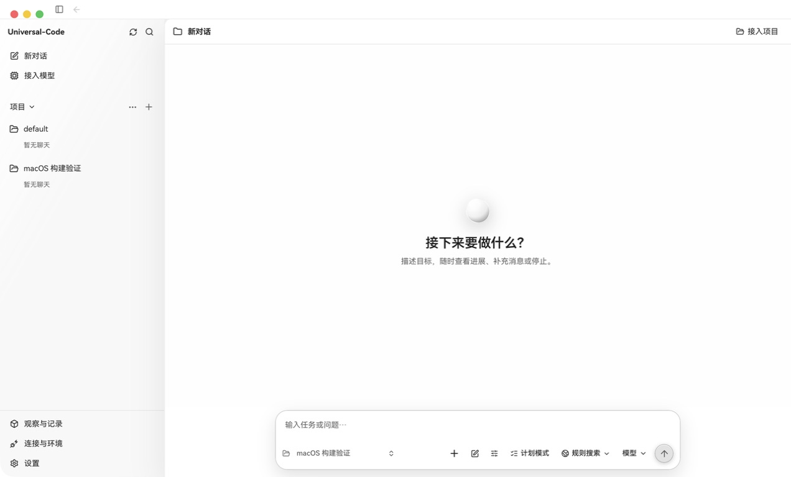

# macOS native build validation (2026-10-20)

This change completes local preview packaging and restores native window controls
on the existing Darwin desktop implementation. It does not promote the preview
to a Developer ID signed or notarized release.

## Fixes

- `scripts/macos-release.py` writes UTF-8/LF manifest and checksum bytes without
  `Path.write_text(newline=...)`, which is unavailable in the Python 3.9 shipped
  with Xcode command line tools. The regression test exercises `package()` and
  re-verifies its resulting sidecars, in addition to the archive rejection tests.
- The Darwin platform override disables the shared frameless setting. Wails only
  installs the native titlebar/close control when the window is not frameless;
  `TitleBarHiddenInset()` still lets the renderer fill the window. V2 navigation
  reserves the native traffic-light area at all window widths.
- Regular native CI runs on both `macos-15` (arm64) and `macos-15-intel` (amd64),
  checks the runner/Go architecture, and uploads distinct preview artifacts.
  Packaging changes also run the archive suite under Python 3.9.
- The bundled guide now describes the implemented Keychain store and separates
  the external Terminal.app launcher from the unavailable embedded Debug terminal
  and Windows-specific isolation capabilities.

## Reproduce locally

Use Node.js 24, the exact Go version in `go.mod`, Xcode command line tools and
Python 3.9 or newer. On a clean checkout:

```sh
cd web
npm ci
npm run check:api
npm test -- --maxWorkers=1
npm run build
cd ..
python3 -B -m unittest discover -s scripts -p test_macos_release.py -v
bash scripts/release-desktop-darwin.sh v1.0.0-macos.20261020 "$(git rev-parse HEAD)" "$(go env GOARCH)"
```

The release wrapper requires a clean checkout, builds twice, checks the native
Mach-O/signature/metadata, generates licenses and SBOM, creates the ZIP, and
extracts it into a new directory for verification. Artifacts are in
`build/macos-public`. `TraverseBoard.app` and its bundle identifier retain their
existing compatibility names.

For a local UI check, launch with a separate application data directory:

```sh
mkdir -p .tmp/macos-smoke
CYBERAGENT_HOME="$PWD/.tmp/macos-smoke" \
  ./build/desktop/TraverseBoard.app/Contents/MacOS/cyberagent-desktop
```

Inspect the native traffic lights and sidebar controls, register a disposable
project folder, close the app with its native close control, and relaunch with
the same data directory to check persistence. The data override isolates the
application database; system Keychain and WebKit storage are still associated
with the app identity. No real provider credentials are needed for this check.

## Observed native smoke

On macOS 26.5.2 (25F84), Apple Silicon, with Go 1.26.9 / Node 24.19.0 /
Python 3.9.6:

- Frontend production build, desktop-tag boundary tests, 17 archive tests and
  real isolated Keychain integration passed.
- Consecutive native binary builds matched; all 14 automated compatibility
  checks passed, including the ad-hoc signature and macOS 12 deployment target.
- The native close/minimize/zoom controls are present; sidebar toggle works.
- The native folder picker registered a disposable project. Closing via the
  native close button exited with status 0; relaunching with the same data
  directory preserved the project. SQLite integrity was `ok`, with no foreign
  key violations.

This smoke screenshot uses the development working tree based on `3341c0e3`,
including this PR's changes, before the final clean archive build. It shows no
real credentials or model responses.



For the full Go suite on a local Mac, use a physical temporary directory: the
system `/var` path is a symlink to `/private/var`, which correctly triggers some
workspace anti-redirection checks when used as a fixture root.

```sh
mkdir -p .tmp/go-tests
TMPDIR="$PWD/.tmp/go-tests" go test -count=1 ./...
go vet ./...
```

## Evidence boundary

This is an ad-hoc signed preview, with `release_ready=false`. A local Apple
Silicon launch cannot establish Intel hardware behavior, macOS 12 support on a
clean machine, Gatekeeper acceptance, Keychain upgrade/lock/cancel behavior, or
real model execution. Developer ID signing, notarization and final-package
acceptance remain tracked by issue #336.
